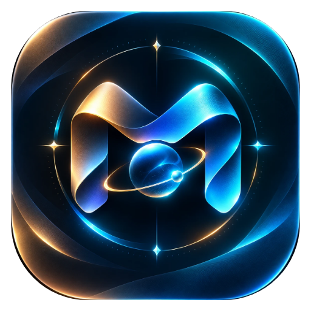
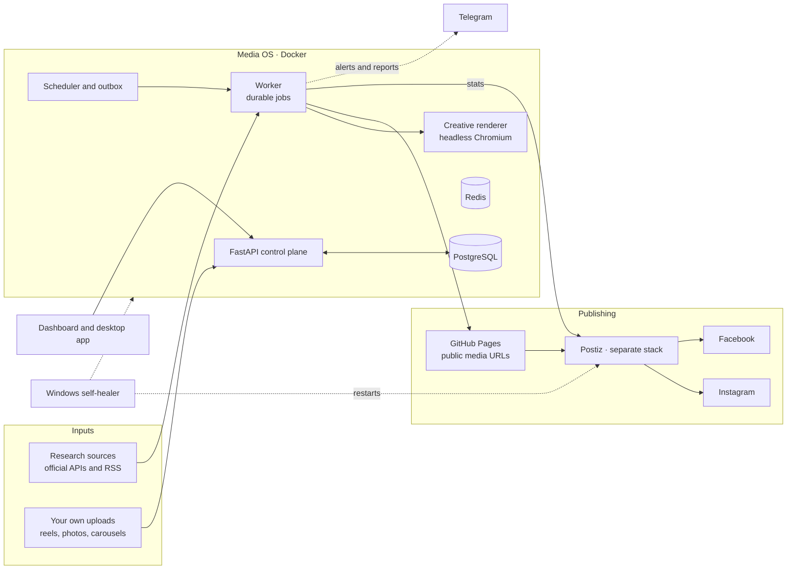

<a id="top"></a>

<div align="center">



# Media OS Agent

**A local-first AI media studio that researches, writes, renders, schedules and tracks social posts, and tells you on Telegram the moment anything goes wrong.**

[](https://github.com/psuvraneel-cyber/Media-OS-Agent/actions/workflows/ci.yml)
[](https://github.com/psuvraneel-cyber/Media-OS-Agent/releases)


[Features](#features) · [How it works](#how-it-works) · [Quick start](#quick-start) · [Operations](#operations) · [Docs](#documentation) · [Releases](#releases)

</div>

---

## Contents

- [Features](#features)
- [How it works](#how-it-works)
- [Project status](#project-status)
- [Quick start](#quick-start)
- [Operations](#operations)
- [Repository layout](#repository-layout)
- [Documentation](#documentation)
- [Releases](#releases)
- [Principles](#principles)
- [License](#license)

---

## Features

<table>
<tr>
<td width="50%" valign="top">

### 🎨 Studio
Upload your own **reels** (MP4), **photos** and **carousels** (2–10 slides, in the order you set). Write the caption, approve, then schedule one at a time or as a batch ("one a day at 7 PM").

</td>
<td width="50%" valign="top">

### 🤖 AI carousels
Brand-aware carousel writing on free-tier AI, automatic QA (language, claims, length), a virality score and pixel-perfect rendering in headless Chromium.

</td>
</tr>
<tr>
<td valign="top">

### 📅 Publishing
Approved posts go to **Instagram** and **Facebook** through a self-hosted [Postiz](https://github.com/gitroomhq/postiz-app). Daily caps, 5-minute spacing, automatic retry of temporary errors, and a publishing calendar.

</td>
<td valign="top">

### 📈 Analytics
Per-post views, likes, comments, shares and saves, with period-over-period growth, plus **whole-account totals** that include posts made directly in the apps. **Refresh analytics** fetches the latest on demand.

</td>
</tr>
<tr>
<td valign="top">

### 🔔 Never fails silently
Telegram alerts for failed, stuck or overdue posts, a **10 PM nightly report**, and bot commands (`/status`, `/queue`, `/help`).

</td>
<td valign="top">

### 🛠️ Self-healing
A Windows watchdog restarts a disconnected Postiz worker, unhealthy or stopped containers and a quiet alert system. Restart Postiz from the dashboard with one click, and get an optional PC-off alarm via Healthchecks.io.

</td>
</tr>
<tr>
<td valign="top">

### 🏷️ Multi-brand
Every post, asset, approval and number is scoped to a brand profile, with its own logo, voice, pillars and caps.

</td>
<td valign="top">

### 🖥️ Desktop app
A frosted-glass (Windows Acrylic) Electron app with its own icon and splash screen, or use the web dashboard at `127.0.0.1:3100`.

</td>
</tr>
</table>

<p align="right"><a href="#top">↑ Back to top</a></p>

---

## How it works



1. **Create:** AI drafts carousels from brand briefs, or you upload your own reels and photos in Studio.
2. **Check and approve:** automatic QA, then nothing is published without your approval.
3. **Schedule:** the worker hosts the media on GitHub Pages and creates the post in Postiz, which publishes at the chosen time.
4. **Track:** status syncs every 15 minutes, and stats every 6 hours, nightly and on demand.
5. **Watch:** in-app watchdogs plus a host self-healer keep it running, and report on Telegram.

<p align="right"><a href="#top">↑ Back to top</a></p>

---

## Project status

| Milestone | What it delivered | Status |
|---|---|---|
| Phases 0–4 | Contract, Docker baseline, standalone Postiz, dashboard and API skeleton, PostgreSQL, Redis, multi-brand schema, durable jobs, scheduler | ✅ Done |
| Phase 5 | Research ingestion: five live-verified official connectors, Research and Topics UI | ✅ Done (sources off until enabled) |
| N0–N1 | Nimontron brand onboarding, free-tier AI adapter | ✅ Done |
| N2–N3 | AI carousels with QA and scoring; scheduled publishing to Instagram and Facebook | ✅ Done |
| Dashboard and desktop | Visual overhaul, live stats, Electron app (Acrylic) | ✅ Done |
| Reliability | Telegram alerts, nightly report, bot commands, self-healer, auto-retry | ✅ Done |
| Studio | Your own reels, photos and carousels; brand logo; Sync now; account-wide stats; restart Postiz | ✅ Done |
| Next | Link accounts to brands and a New brand form, YouTube Shorts (after Google's review), autopilot (daily posts with a cancel window) | 🔜 Planned |

<p align="right"><a href="#top">↑ Back to top</a></p>

---

## Quick start

> Built for a single owner on Windows 11 with Docker Desktop (WSL2). Everything runs on `127.0.0.1`.

**Prerequisites:** Docker Desktop, Python 3.12, Node.js 20+, Git.

```bash
git clone https://github.com/psuvraneel-cyber/Media-OS-Agent.git
cd Media-OS-Agent/media-intelligence-os
```

1. **Configure:** copy [`media-intelligence-os/.env.example`](media-intelligence-os/.env.example) to a runtime `.env` outside the repo and fill it in. Secrets never go into Git.
2. **Start Postiz** (its own stack): see [`docs/POSTIZ_DEPLOYMENT.md`](media-intelligence-os/docs/POSTIZ_DEPLOYMENT.md).
3. **Start Media OS:**
   ```bash
   docker compose --env-file "<runtime>/.env" -f infra/docker/compose.app.yml up -d --build --wait
   docker exec media-os-api alembic upgrade head
   ```
4. **Open the dashboard** at <http://127.0.0.1:3100>, or run the desktop app: `cd apps/desktop && npm start`.
5. **Install the self-healer** (no admin rights needed): [`infra/ops/windows`](media-intelligence-os/infra/ops/windows/README.md).

Local development and tests: [`CONTRIBUTING.md`](media-intelligence-os/CONTRIBUTING.md).

<p align="right"><a href="#top">↑ Back to top</a></p>

---

## Operations

| You want to | Go to |
|---|---|
| Understand every alert, the nightly report and the self-healer | [`docs/OPERATIONS.md`](media-intelligence-os/docs/OPERATIONS.md) |
| Install, pause or test the Windows self-healer, or restart Postiz from the dashboard | [`infra/ops/windows/README.md`](media-intelligence-os/infra/ops/windows/README.md) |
| Back up and restore-verify the database | `python scripts/backup_db.py` · `python scripts/restore_verify.py` |
| Check the stack from your phone | Send `/status` to your Telegram bot |
| Publishing internals (hosting, Postiz, retries) | [`docs/N3_PUBLISHING.md`](media-intelligence-os/docs/N3_PUBLISHING.md) |

<p align="right"><a href="#top">↑ Back to top</a></p>

---

## Repository layout

```text
Media-OS-Agent/
├── .github/workflows/ci.yml      # Lint, types, unit, PostgreSQL/Redis integration, web build
└── media-intelligence-os/
    ├── apps/
    │   ├── api/                  # FastAPI · SQLAlchemy · Alembic · durable jobs · Postiz client
    │   ├── web/                  # Next.js 16 dashboard and BFF proxy
    │   └── desktop/              # Electron shell (Acrylic, splash, icon)
    ├── infra/
    │   ├── docker/               # compose.app.yml and Dockerfiles
    │   ├── creative/             # Bengali fonts for the carousel renderer
    │   └── ops/windows/          # Self-healer, restart helper, installers
    ├── docs/                     # PRD, roadmap, architecture, decisions, operations
    ├── scripts/                  # Backups, secret scanner, manifests
    └── tests/                    # Unit, integration (throwaway DBs), smoke
```

<p align="right"><a href="#top">↑ Back to top</a></p>

---

## Documentation

| Topic | Document |
|---|---|
| Product requirements | [PRD](media-intelligence-os/docs/PRD.md) |
| Roadmap | [ROADMAP](media-intelligence-os/docs/ROADMAP.md) |
| Architecture | [ARCHITECTURE](media-intelligence-os/docs/ARCHITECTURE.md) |
| Decisions log | [DECISIONS](media-intelligence-os/docs/DECISIONS.md) |
| Security model | [SECURITY](media-intelligence-os/docs/SECURITY.md) |
| Environment variables | [ENVIRONMENT](media-intelligence-os/docs/ENVIRONMENT.md) |
| Operations and alerts | [OPERATIONS](media-intelligence-os/docs/OPERATIONS.md) |
| Carousel pipeline | [N2_CAROUSEL_PIPELINE](media-intelligence-os/docs/N2_CAROUSEL_PIPELINE.md) |
| Publishing | [N3_PUBLISHING](media-intelligence-os/docs/N3_PUBLISHING.md) |
| Postiz deployment | [POSTIZ_DEPLOYMENT](media-intelligence-os/docs/POSTIZ_DEPLOYMENT.md) |
| Handoff notes | [HANDOFF](media-intelligence-os/docs/HANDOFF.md) |
| Core monorepo overview | [media-intelligence-os/README](media-intelligence-os/README.md) |

<p align="right"><a href="#top">↑ Back to top</a></p>

---

## Releases

See all [releases](https://github.com/psuvraneel-cyber/Media-OS-Agent/releases) for full notes.

| Version | Highlights |
|---|---|
| **v1.0.0** | Studio (own reels, photos, carousels), brand logo, Sync now, whole-account stats, restart Postiz from the dashboard |
| v0.9.0 | Never fails silently: Telegram alerts, self-healer, nightly report, bot commands, auto-retry |
| v0.8.0 | Dashboard visual overhaul, live stats and the Electron desktop app |
| v0.7.0 | AI carousels with QA and scoring; scheduled publishing to Instagram and Facebook |
| v0.6.0 | Nimontron brand onboarding and the free-tier AI adapter |
| v0.5.0 | Research ingestion, plus the persistent multi-brand platform underneath |

<p align="right"><a href="#top">↑ Back to top</a></p>

---

## Principles

- **You approve everything.** Nothing is published without an explicit approval and schedule.
- **Postiz stays separate.** It runs in its own stack, and Media OS only uses its public API.
- **Official sources only.** Reddit is blocked by policy; research uses official APIs and feeds.
- **₹0 budget.** Free tiers and self-hosting only; no paid APIs or hosting.
- **Secrets stay out of Git.** Runtime `.env` lives outside the repo, and pre-commit hooks scan for secrets.
- **Fail loudly.** Every failure path ends in a Telegram message, not a silent log line.

<p align="right"><a href="#top">↑ Back to top</a></p>

---

## License

Personal project, currently **unlicensed** (all rights reserved). Not accepting external contributions.

<div align="center">

Built with FastAPI, Next.js, PostgreSQL, Redis, Docker and Electron.

<a href="#top">↑ Back to top</a>

</div>
