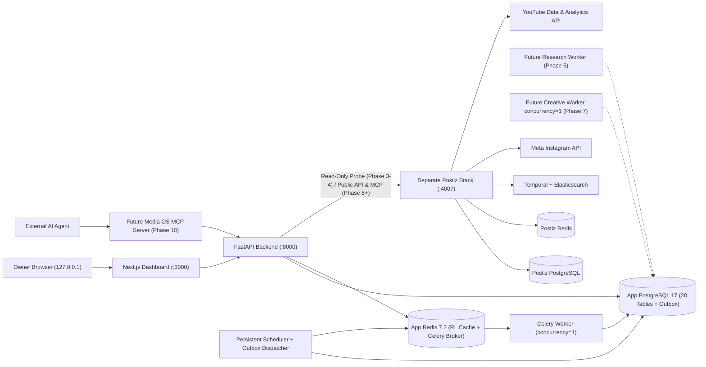

# System Architecture — Media Intelligence OS

**Document Status:** Phase 4 Persistence, Multi-Brand Schema, Durable Jobs & Workflow Architecture
**Last Updated:** 2026-11-10

---

## 1. Architectural Overview & Strict Boundaries

Media Intelligence OS uses a **two-stack local-first architecture** to strictly separate multi-brand AI research/content production from social-platform OAuth and publishing:

1. **Custom Application Stack (`media-intelligence-os`):** Owns PostgreSQL persistence, Redis/Celery durable job infrastructure, transactional outbox & scheduler, shared research intelligence, `BrandProfile` & `ChannelAccount` isolation, validated 19-state content workflow, future brand-specific creative generation (Gemini + TTS + Playwright/Pillow + FFmpeg), quality assurance, human approval workflows, and a scoped external MCP server.
2. **Separate Publishing Stack (`postiz-runtime`):** Deployed independently in `C:\Media OS Agent\postiz-runtime` using pinned release **`v2.25.3`** (`ghcr.io/gitroomhq/postiz-app:v2.25.3`). Owns social-account OAuth flows, token refresh, Postiz scheduling queues (Temporal), social platform API adapters (multiple Instagram Business/Standalone accounts, YouTube), and supported post analytics. *(The older `C:\Media OS Agent\postiz-app-main` archive remains untouched as a historical reference.)*

---

## 2. Service Ownership Boundaries (Non-Negotiable)

| Domain | Owner | Prohibited Cross-Boundary Actions |
|---|---|---|
| Research sources, Research Packets, Claims | **Media Intelligence OS** | Postiz must not manage our research state. |
| Content generation, Carousels, Shorts, QA | **Media Intelligence OS** | Do not call Postiz's Mastra/OpenAI generators or modify Postiz UI for QA. |
| Approval state (`PENDING_APPROVAL`, `APPROVED`) | **Media Intelligence OS** | Never mark a job approved inside Postiz DB; enforce approval in FastAPI before calling Postiz API. |
| Social OAuth tokens & refresh cycles | **Postiz** | Media Intelligence OS must never read Postiz's PostgreSQL tables or reuse SocialAI's `meta.py`/`youtube.py` token files. |
| Social scheduling & platform posting | **Postiz** | Media Intelligence OS communicates exclusively via Postiz Public API (`/api/public/v1/...`) or Postiz MCP (`/mcp`). |
| Postiz internal storage & Temporal workflows | **Postiz** | Never merge Postiz code (AGPL-3.0), copy Postiz service classes, alter Postiz DB schema, or remove Temporal/ES without proving release compatibility. |

---

## 3. Component Breakdown (`media-intelligence-os`)

| Component | Path | Verified Technology | Implementation Phase |
|---|---|---|---|
| **Web Dashboard** | `apps/web/` | Next.js 16 + TypeScript + Tailwind CSS (standalone BFF shell, persisted Brand switcher & channel views) | Phase 3 & Phase 4 (live brands) |
| **Backend API** | `apps/api/` | Python 3.12 + FastAPI (`media-os-api`), sync SQLAlchemy 2.x + `psycopg`, persistent owner auth/session revocation, workflow & brand APIs | Phase 3 & Phase 4 |
| **Database & Migrations** | `apps/api/src/media_os_api/db/`, `apps/api/migrations/` | PostgreSQL 17 Alpine + Alembic (`0001_initial_phase4_schema`, `0002_seed_initial_brands`, `0003_domain_integrity_hardening`, `0004_add_brand_topic_assignments`) | **Active in Phase 4 / Pre-Phase 5** |
| **Broker / Cache** | `infra/docker/compose.app.yml` | Redis 7.2 (`requirepass`, `appendonly`, `noeviction`) | **Active in Phase 4** |
| **Durable Job Worker & Dispatcher** | `apps/api/src/media_os_api/jobs/` | Celery (`concurrency=1`, JSON-only) + `FOR UPDATE SKIP LOCKED` Outbox & DST-aware Scheduler (`media-os-scheduler`) | **Active in Phase 4** |
| **Research Worker** | `workers/research/` | Python 3.12 + Celery | Phase 5 |
| **Creative Worker** | `workers/creative/` | Python 3.12 + Celery (`concurrency=1`), HTML/CSS/SVG/Pillow/Playwright, FFmpeg | Phase 7 |
| **MCP Server** | `services/mcp/` | Controlled Python MCP server calling Backend API | Phase 10 |
| **AI & Voice Layer** | `apps/api/` adapter | Centralized Gemini Developer API + Gemini TTS client | Phase 7 |

---

## 4. Verified Local Network & Port Map

All ports verified against live host listeners, `C:\Media OS Agent\postiz-runtime\docker-compose.yaml`, `infra/docker/compose.app.yml`, and Postiz `v2.25.3` nginx proxy rules:

| Service | Host Bind | Host Port | Container Port | Stack | Notes |
|---|---|---|---|---|---|
| **Dashboard (`media-os-web`)** | `127.0.0.1` | `3000` | `3000` | Media OS (`media-os-net`) | Active standalone Next.js 16 SSR + BFF proxy. |
| **Backend API (`media-os-api`)** | `127.0.0.1` | `8000` | `8000` | Media OS (`media-os-net`) | Active FastAPI control plane; Phase 1 baseline uses `127.0.0.1:8000` only when stopped. |
| **App PostgreSQL (`media-os-postgres`)** | Internal Docker network only | None exposed on host | `5432` | Media OS (`media-os-net`) | Isolated `media_os_pgdata` volume; zero host port exposure. |
| **App Redis (`media-os-redis`)** | Internal Docker network only | None exposed on host | `6379` | Media OS (`media-os-net`) | Isolated `media_os_redisdata` volume; `requirepass` + AOF persistence. |
| **Worker & Scheduler (`media-os-worker`, `media-os-scheduler`)** | Internal Docker network only | None exposed on host | — | Media OS (`media-os-net`) | Read-only non-root containers executing durable control/maintenance jobs and outbox/scheduler ticks. |
| **Postiz Unified Entry** | `127.0.0.1` | `4007` | `5000` | `postiz-runtime` | Bound strictly to loopback (`127.0.0.1:4007:5000`); accessed via `http://localhost:4007`. |
| **Postiz Internals (Temporal / Postgres / Redis / ES)** | Internal Docker network only | None exposed on host | `7233` / `8080` / `5432` / `6379` / `9200` | `postiz-runtime` | Internal `postiz-runtime-network` and `postiz-temporal-network` only. |

---

## 4A. Conceptual Multi-Brand & Multi-Channel Architecture (Phase 3+ Target)

- **`BrandProfile` (Independent Content Identity):** Defines `brand_id`, `brand_name`, `description`, `niche`, `audience`, `language`, `tone_of_voice`, `content_pillars`, `visual_identity`, `logo_and_asset_references`, `caption_conventions`, `hashtag_preferences`, `cta_preferences`, `publishing_cadence`, `approval_policy`, and `active` flag. Initial target identities: **Brand Profile 1 (Technology and AI)** and **Brand Profile 2 (App Promotion — app details configured later)**.
- **`ChannelAccount` (External Destination Binding):** Maps a `BrandProfile` to a specific Postiz integration ID / platform account (multiple Instagram accounts, optional multiple YouTube channels), carrying independent integration pointers, schedules, calendars, analytics, and approval settings.
- **`BrandTopicAssignment` (Brand-Specific Editorial Bridge):** Persists brand-specific screening, priority, and relevance scoring for a shared `TopicCluster`. Maintains `(brand_profile_id, topic_cluster_id)` uniqueness and enforces editorial status (`PENDING_EVALUATION`, `CONSIDERED`, `SHORTLISTED`, `APPROVED_FOR_RESEARCH`, `REJECTED`, `EXPIRED`) with bounded relevance scores (`0.0000 <= score <= 1.0000`).
- **Shared Intelligence, Brand-Specific Execution:**
  1. **Global Source Ingestion:** `source_items` and `topic_clusters` are globally deduplicated across external providers (no `brand_profile_id`). Discovery runs once globally.
  2. **Decoupled Editorial Routing:** Every candidate topic is assigned per-brand via `BrandTopicAssignment`. Brand 1 can approve and prioritize an AI story while Brand 2 rejects or ignores it.
  3. **Strict Research Gating:** `ResearchPacket` requires an existing `BrandTopicAssignment` via PostgreSQL composite foreign key `fk_research_packets_brand_topic (brand_profile_id, topic_cluster_id)`. The service layer enforces that packets can only be initialized from `APPROVED_FOR_RESEARCH` or `SHORTLISTED` assignments.
  4. **Downstream Production Scoping:** Generation, visual rendering, QA, and scheduling bind every `ContentPackage`, `Asset`, `Schedule`, and `Post` to an explicit `(brand_id, channel_account_id)` pair.
  5. **Account-Level Publish Safeguards:** Before invoking Postiz `/public/v1/posts`, the API adapter verifies that `ContentPackage.brand_id == ChannelAccount.brand_id` and that `ChannelAccount.postiz_integration_id` matches the target destination account, blocking accidental cross-account publishing.

---

## 5. End-to-End Data Flow

1. **Discovery (`workers/research`):** Scheduled Celery Beat jobs trigger enabled source connectors (`OFF`/`BLOCKED` connectors cannot run). Raw payloads are sanitized as untrusted text, normalized, and stored in PostgreSQL with canonical source URLs and hashes.
2. **Deduplication & Ranking:** Keyword/semantic similarity + URL canonicalization reject near-duplicates against previously produced or queued topics. Candidate stories are scored by source weight, freshness, and bounded historical category performance.
3. **Verification & Editorial Selection:** High-ranking candidates enter deep primary-source inspection (e.g., official paper/release/repo) to produce a structured `ResearchPacket` with cited claims.
4. **Generation & Rendering (`workers/creative`, concurrency = 1):**
   - Calls centralized Gemini adapter for structured script/slide JSON (subject to daily token/budget caps and circuit breaker).
   - Renders Instagram carousel PNGs via HTML/CSS/SVG + Playwright/Pillow.
   - Generates voiceover via Gemini TTS and composites `9:16` Shorts with FFmpeg.
5. **Quality Assurance Gate:** Deterministic validators + editorial checks verify slide legibility, video resolution/duration/audio sync, synthetic-disclosure flags, blocked phrases, and claim citations.
6. **Human Review (`apps/web`):**
   - Instagram carousels enter **draft/review mode** in Phase 8.
   - YouTube Shorts enter `pending_approval` and require explicit owner sign-off (artifact + channel + title/description/tags + visibility) before submission.
7. **Publishing Hand-off (`Postiz`):**
   - Once approved, FastAPI uploads media and schedules/creates drafts or approved posts via Postiz `http://localhost:4007/api/public/v1/*` (`Authorization: <POSTIZ_API_KEY>`, raw key) or `http://localhost:4007/api/mcp` (`Authorization: Bearer <POSTIZ_API_KEY>`).
   - **Verified Phase 2 Draft Behavior:** Postiz `v2.25.3` (`posts.service.ts`) requires a valid connected `integration.id` on `POST /api/public/v1/posts` even when `type: "draft"`.
   - **Instagram Public URL Requirement:** Meta's Instagram Graph API fetches media from a **public HTTPS URL** (verified in both Postiz `cloudflare.storage.ts` and SocialAI `meta.py`). Localhost URLs (`/uploads` on `localhost:4007`) are invalid for live Instagram Graph API ingestion; public HTTPS media delivery (e.g., Cloudflare R2) will only be configured later when explicitly approved by the owner.
8. **Analytics & Learning:** Periodic read-only polls to Postiz `/public/v1/analytics/:integration` and `/analytics/post/:postId` update our PostgreSQL metrics table and compute bounded category multipliers once sufficient samples exist.

---

## 6. Hardware Constraint Strategy (`i5-13420H` / `16 GB RAM`)

- **Remote Inference Only:** All LLM and TTS workloads run remotely on Gemini Developer API (no local Ollama or local Whisper models unless strictly required and profiled later).
- **Single Creative Concurrency:** `workers/creative` processes 1 heavy Playwright/FFmpeg job at a time (`CELERY_CONCURRENCY=1`) to avoid OOM spikes or thermal throttling.
- **Measured Docker Footprint:** Docker Desktop allocates `~7.61 GiB` (`8,166,977,536` bytes) to the Linux engine. Phase 2 verified the 8 running `postiz-runtime` containers (`spotlight` disabled under `debug` profile) stabilize at `~2.8 GiB` WSL used (`~1.23–1.51 GiB` for `postiz-runtime-app` idle, `~2.11 GiB` peak startup, `~4.4–7.0 GB` host `vmmemWSL`). See [`docs/POSTIZ_RESOURCE_PROFILE.md`](./POSTIZ_RESOURCE_PROFILE.md).
