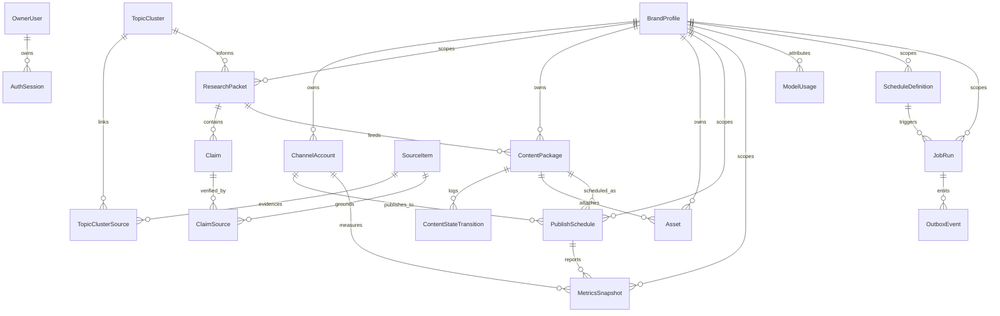

# Phase 4 Implementation Report — Persistent Database, Multi-Brand Data Model, Durable Jobs & Workflow State Machine

**Completed Date:** 2026-11-10
**Governing Commit Before Phase 4:** `b45bded`
**Runtime Stack:** Docker Compose (`infra/docker/compose.app.yml`) — **6 isolated Media OS containers** (`media-os-postgres`, `media-os-redis`, `media-os-api`, `media-os-worker`, `media-os-scheduler`, `media-os-web`) alongside independent `postiz-runtime` (`8` containers)

---

## 1. Executive Summary

Phase 4 transforms **Media Intelligence OS** from a non-persistent Phase 3 control-plane skeleton into a **PostgreSQL-backed, Redis-coordinated, multi-brand-isolated, crash-recoverable runtime** while maintaining strict separation from `postiz-runtime` and honoring laptop memory limits (`16 GB` host RAM / `~7.61 GiB` WSL2 allocation).

Implemented without touching Phase 5+ features (no research connectors, LLM/TTS generation, FFmpeg rendering, OAuth flows, or production Postiz publishing adapters):

1. **Dedicated Application PostgreSQL (`postgres:17-alpine`) & Redis (`redis:7.2`)** bound strictly to internal `media-os-net` (zero published Windows host ports).
2. **Unified Synchronous SQLAlchemy 2.x + `psycopg[binary]` Data Layer** with bounded pooling, explicit `UTC` storage (`TIMESTAMPTZ`), configurable display timezone (`APP_DISPLAY_TIMEZONE=Asia/Kolkata`), and clean unavailability handling (`HTTP 503`).
3. **Alembic Migration Chain (`0001_initial_phase4_schema` → `0002_seed_initial_brands` → `0003_domain_integrity_hardening`)** defining 20 domain/control tables, composite cross-brand foreign keys, PostgreSQL triggers, operational indexes, and idempotent seeding for Brand 1 (`brand-tech-ai`) and Brand 2 (`brand-app-promo`, explicitly unconfigured).
4. **Persistent Single-Owner Authentication & Revocation:** `OwnerUser` + `AuthSession` in PostgreSQL, Argon2id verification, `token_version` invalidation, duplicate-bootstrap password overwrite protection, deliberate `rotate_password` CLI rotation, and Redis-backed sliding-window login rate limiting persisting across API restarts.
5. **Durable Job Ledger, Transactional Outbox & Persistent Scheduler:** `JobRun` + `OutboxEvent` atomic enqueueing, `FOR UPDATE SKIP LOCKED` outbox dispatcher, JSON-only Celery worker (`concurrency=1`), stale lease recovery, and DST-safe `ScheduleDefinition` runner (`zoneinfo` + `fold=0` ambiguity guard).
6. **19-State Content Workflow State Machine & Retention Registry:** Strict transition table (`DISCOVERED`..`ARCHIVED` plus `FAILED_RETRYABLE`, `FAILED_FINAL`, `REJECTED`, `PAUSED`), hold-state resume lock to `previous_status`, idempotent transition keys, audit trails, dry-run/protected-asset cleanup, and YouTube 30-day metadata/metrics TTL caps.
7. **Isolated Backup & Restore Tooling:** Non-destructive host `pg_dump -Fc` + SHA-256 verification (`scripts/backup_db.py`) and isolated temporary-DB restoration (`scripts/restore_verify.py`) outside Git.
8. **Dashboard Integration:** Authenticated FastAPI + Next.js BFF displaying live PostgreSQL brands (`brand-tech-ai`, `brand-app-promo`, including inactive brands so they remain reactivatable), honest empty channel states, brand activation controls (refusing deactivation of the last active brand), and persisted audit events in `/logs`.

---

## 2. Incremental Rollout & Measured Resource Profile

Per Phase 4 reliability rules, services were introduced one at a time on `media-os-net` and verified before advancing:

| Stage | Service Added | Image / Pin | Observed Memory (`docker stats`) | Configured Limit | Status |
|---|---|---|---|---|---|
| **Baseline** | `media-os-api`, `media-os-web` + 8 `postiz-runtime-*` | Phase 3 | API `~43–45 MiB`, Web `~41 MiB`, Postiz `~2.29 GiB` | `256m` / `256m` | Healthy (`WSL 3.2G used / 4.1G avail`) |
| **Stage 1** | `+ media-os-postgres` | `postgres:17-alpine@sha256:3540c0...` | `33.7 MiB` | `512m` | Healthy (`TZ=UTC`, `max_connections=40`, `shared_buffers=128MB`) |
| **Stage 2** | `+ media-os-redis` | `redis:7.2@sha256:5b816b...` | `4.45 MiB` | `128m` | Healthy (`requirepass`, `appendonly=yes`, `noeviction`) |
| **Stage 3** | `+ media-os-worker` + rebuilt `api` | `media-intelligence-os-api:phase4` | Worker `110 MiB`, API `73.31 MiB` | `256m` / `256m` | Healthy (`--concurrency=1 -Q control,maintenance,default`) |
| **Stage 4** | `+ media-os-scheduler` + rebuilt `web` | `media-intelligence-os-api:phase4` | Scheduler `64.52 MiB`, Web `47.75 MiB` | `128m` / `256m` | Healthy (`WSL 3.6G used / 3.8G avail`) |
| **Final Post-Test Steady State** | Full 6 Media OS containers + 8 Postiz | Phase 4 final | API `72.46 MiB`, Web `35.28 MiB`, Worker `88.31 MiB`, Scheduler `56.25 MiB`, Postgres `22.96 MiB`, Redis `4.63 MiB` (**`~279.9 MiB` Media OS total**) | Sum `1,536 MiB` (`1.5 GiB`) | **14/14 containers up; all healthchecks healthy** |

Host measurements at final check: `C:\` free space `371,182,575,616` bytes (`~345.69 GiB` free), WSL2 Docker Engine `3.6 GiB used / 3.8 GiB available` out of `7.6 GiB`, Windows `FreePhysicalMemory` `896,912 KB` (`~876 MiB` free out of `15.70 GiB` total alongside active Windows workstation processes & WSL cache).

---

## 3. Normalized Multi-Brand & Operational Data Model

### 3.1 Entity-Relationship Overview

### 3.2 Implemented Tables (`0001_initial_phase4_schema` + `0003_domain_integrity_hardening`)

All 20 domain/operational tables use UUID primary keys, UTC `TIMESTAMPTZ` `created_at`/`updated_at`, explicit statuses, and targeted operational indexes:

1. **Identity & Auth:** `owner_users`, `auth_sessions` (`jti` indexed, `revoked_at`, `revocation_reason`, `expires_at`).
2. **Multi-Brand Isolation:** `brand_profiles` (supports nullable `logo_asset_id` constrained to same brand via PostgreSQL triggers), `channel_accounts` (`platform` `INSTAGRAM`/`YOUTUBE`, unique `postiz_integration_id`, zero OAuth tokens stored).
3. **Shared Research & Grounded Claims:** `source_items` (canonical URL + `content_hash` + `retention_expires_at`), `topic_clusters`, `topic_cluster_sources`, `research_packets`, `claims`, `claim_sources`.
4. **Content Production & Approval:** `content_packages` (`status`, `previous_status`, DB `CHECK` constraints across the 19 lifecycle states, composite `(id, brand_profile_id)`), `content_state_transitions` (`idempotency_key`), `assets`, `publish_schedules`, `metrics_snapshots`.
5. **Governance, Telemetry & Jobs:** `model_usages` (reserved for Phase 7 accounting), `audit_events` (`before_hash`/`after_hash`, secret-scrubbed metadata), `schedule_definitions` (`timezone`, `schedule_config`, `last_run_at`, `next_run_at`), `job_runs` (`idempotency_key`, `lease_expires_at`, `attempt_count`/`maximum_attempts`), `outbox_events` (`SKIP LOCKED` claim status & dispatch retry schedule).

### 3.3 Database-Layer Integrity Enforcements

- **Cross-Brand Composite Foreign Keys:** `content_packages` ↔ `research_packets`, `assets` ↔ `content_packages`, `publish_schedules` ↔ `channel_accounts`, `publish_schedules` ↔ `content_packages`, and `metrics_snapshots` ↔ `channel_accounts` reference `(id, brand_profile_id)` so cross-brand mismatches are rejected by PostgreSQL itself even outside the service layer.
- **Triggers `media_os_enforce_claim_source` (`trg_claims_require_source_when_verified`) & `media_os_prevent_verified_claim_source_loss` (`trg_claim_sources_protect_verified_claim`):** A `Claim` cannot transition to `VERIFIED` without at least one `ClaimSource`, nor lose its last `ClaimSource` while `VERIFIED` (while still permitting parent `Claim` deletion via cascade).
- **Trigger `media_os_enforce_content_brand_immutable` (`trg_content_packages_brand_immutable`):** Blocks changing `ContentPackage.brand_profile_id` outside explicit `media_os.allow_brand_reassignment = 'true'` audited sessions.
- **Triggers `media_os_enforce_brand_logo_same_brand` (`trg_brand_profiles_logo_same_brand`) & `media_os_protect_brand_logo_asset` (`trg_assets_protect_brand_logo`):** Enforce same-brand ownership when `BrandProfile.logo_asset_id` is assigned or an asset's brand is mutated.

---

## 4. Seeded Brands & Data Governance

Migration `0002_seed_initial_brands` runs `seed_initial_brands()` idempotently:

| Brand | Deterministic UUID | Slug | Language | Initial State |
|---|---|---|---|---|
| **Technology & AI** | `a70033c4-c9a6-5f8f-9379-2c9da3b74ca8` (`uuid5(NAMESPACE_DNS, "media-os.brand-tech-ai")`) | `brand-tech-ai` | `en` | Active (`7` pillars: AI models and releases, AI tools, Open-source projects, GitHub discoveries, AI research, Developer productivity, Software engineering) |
| **App Promotion** | `f04bd301-4d87-5a23-9e24-b5c999066de5` (`uuid5(NAMESPACE_DNS, "media-os.brand-app-promo")`) | `brand-app-promo` | `en` (provisional) | Active, explicitly marked `visual_identity.configured = false` and `logo_asset_id = NULL` (no fabricated app name, logo, colors, features, screenshots, pricing, claims, or user metrics) |

No `ChannelAccount` records are seeded (`connected_channels = 0`).

---

## 5. Authentication, Revocation, Password Rotation & Rate Limiting

- **Persistent Sessions (`auth/persistence.py`):** Every login mints an HMAC-SHA256 signed cookie (`HttpOnly`, `SameSite=Lax`) containing `(sub, jti, iat, exp, token_version)` and inserts an `AuthSession` row storing only `jti` (never the raw cookie).
- **Restart-Safe Revocation:** Logout marks `AuthSession.revoked_at` in PostgreSQL; API restarts never re-enable revoked sessions. Expired records are pruned safely via `cleanup_expired_auth_sessions()` without prematurely dropping unexpired revoked rows.
- **Non-Overwriting Bootstrap & CLI Rotation:** Subsequent restarts skip overwriting an existing `OwnerUser` password hash (`ensure_owner_bootstrapped`). Deliberate rotation via `python -m media_os_api.auth.rotate_password --username <owner>` increments `token_version`, revokes all active sessions atomically, audits `OWNER_PASSWORD_ROTATED`, and blocks reading/modifying files inside the Git repository.
- **Redis Rate Limiting (`auth/rate_limit.py`):** Sliding-window sorted-set pipeline in Redis (`media_os:rl:login:*`). Outage behavior is explicit and configurable via `RATE_LIMIT_FAIL_CLOSED_ON_REDIS_OUTAGE`:
  - `false` (local workstation default): mirrors into bounded in-memory limiter (`LOGIN_RATE_LIMIT_MAX_ATTEMPTS / WINDOW_SECONDS`) and logs degraded warning.
  - `true` (strict fail-closed mode): raises `RateLimiterUnavailableError` → HTTP `503`.

---

## 6. Durable Jobs, Outbox Dispatcher, Celery Worker & Scheduler

- **Transactional Outbox:** `enqueue_durable_job()` validates payloads via `validate_safe_task_payload()` (rejecting secret keys/tokens) and atomically inserts `JobRun` + `OutboxEvent` inside one PostgreSQL transaction.
- **Duplicate & Crash Protection:**
  - Unique `JobRun.idempotency_key` deduplicates identical submissions and raises `JobIdempotencyConflictError` if reused with different task/payload.
  - Dispatcher (`jobs/outbox.py`) claims due/expired-lease rows with `SELECT ... FOR UPDATE SKIP LOCKED` (skipping already-terminal `JobRun` rows), publishes **JSON-only** messages (`media_os.execute_job_run`) with unique dispatch IDs to Celery, guards post-publish status updates against fast-worker retry races, and dead-letters cleanly on persistent broker failure.
  - Worker execution (`jobs/ledger.py`) acquires a timed DB row lease (`RUNNING`, `lease_expires_at`) and records `SUCCEEDED`, bounded `FAILED_RETRYABLE` backoff (resetting outbox dispatch attempts for clean retry delivery), or immediate `FAILED_FINAL` on permanent/auth/policy errors.
  - Scheduler runner (`jobs/scheduler.py`) evaluates enabled `ScheduleDefinition` rows via `FOR UPDATE SKIP LOCKED` inside per-schedule nested savepoints, converts schedules using IANA `ZoneInfo` (`fold=0` for DST fall-back disambiguation), advances `next_run_at` strictly past `now` (anti-burst guarantee after laptop sleep), and reaps stale worker leases (`recover_stale_leases`).
- **Authorized Phase 4 Tasks Only:** `media_os.internal.ping` and `media_os.internal.retention_dry_run` (`PHASE4_TASK_REGISTRY`). Queues `control`, `maintenance`, `default`, `research` (reserved), and `creative` (reserved) are registered cleanly.

---

## 7. Content Lifecycle State Machine & Retention Compliance

- **19 Validated States (`workflow/state_machine.py`):** `DISCOVERED`, `NORMALIZED`, `DEDUPED`, `RANKED`, `RESEARCHED`, `DRAFTED`, `RENDERED`, `QA_PASSED`, `POSTIZ_DRAFT`, `USER_APPROVED`, `SCHEDULED`, `PUBLISHING`, `PUBLISHED`, `METRICS_CAPTURED`, `ARCHIVED`, `FAILED_RETRYABLE`, `FAILED_FINAL`, `REJECTED`, `PAUSED`.
- **Hold Resume Lock:** Entering `PAUSED` or `FAILED_RETRYABLE` snapshots `previous_status`; leaving a hold state is valid **only** back to that exact `previous_status` or to `REJECTED`/`FAILED_FINAL`/`ARCHIVED`.
- **Idempotency & Audit:** Every transition accepts `idempotency_key` (returning existing transition on identical replay, rejecting mismatched target reuse) and atomically appends both `ContentStateTransition` and `AuditEvent`.
- **Retention & YouTube ToS (`db/retention.py`):** `RetentionPolicyRegistry` clamps all `YOUTUBE*` `SourceItem` providers and `YOUTUBE` `MetricsSnapshot` TTLs at **≤ 30 days** (`YOUTUBE_POLICY_MAX_DAYS = 30`), sets `MEDIA_TEMP_SUCCESS` (`TEMP_SUCCESS`, `0` days post-QA), `MEDIA_TEMP_FAILED` (`TEMP_FAILED`, `7` days via `RETENTION_FAILED_TEMP_MEDIA_DAYS=7`), and `MEDIA_FINAL` (retained until deleted), and rejects `REDDIT` (`BLOCKED`). `run_retention_evaluation(..., dry_run=True)` previews cleanup counts without deleting expired records, and live cleanup skips expired temporary assets referenced as a `BrandProfile` logo or linked to an active/scheduled `ContentPackage`.

---

## 8. Backup & Isolated Restore Verification

- **Backup Creation:** `python scripts/backup_db.py` executes `pg_dump -Fc` inside `media-os-postgres` (never exposing DB passwords on stdout or argv), writes timestamped `.dump` + `.dump.sha256` outside Git in `C:\Media OS Agent\media-os-backups\`, and validates the archive TOC with `pg_restore --list`.
- **Isolated Restore Check:** `python scripts/restore_verify.py` verifies the SHA-256 sidecar, creates a disposable temporary database `media_os_restore_verify_<ts>_<hex>`, runs `pg_restore --exit-on-error`, confirms Alembic head `0003_domain_integrity_hardening`, compares row counts and SHA-256 content checksums for `brand_profiles`, `schedule_definitions`, `job_runs`, and non-secret `owner_users` fields against the live DB, and drops the temporary DB afterward.

---

## 9. Verification Summary (All Executed Commands)

| Check | Outcome | Evidence |
|---|---|---|
| `ruff format --check .`, `ruff check .`, `mypy` | **PASS** | 94 Python files formatted, 0 Ruff errors, 0 MyPy strict issues across 69 files |
| `scripts/scan_secrets.py` & `scripts/generate_ref_manifests.py --verify` | **PASS** | Zero leaked secrets/forbidden files; 1,042 Postiz + 38 SocialAI reference files match SHA-256 manifests |
| Host `RUN_LIVE_RESTART_TESTS=1 pytest tests/unit tests/integration` | **PASS (33/33 non-DB/Redis + 13/13 DB/Redis in-network = 46/46)** | 20 unit tests, Compose checks (`test_compose_config.py`, `test_phase3_compose.py`), no-DB boundary (`test_phase3_api.py`), live Postiz (`test_postiz_api_mcp.py`, 5/5), backup/restore & sequential 6-container restart (`test_phase4_backup_and_restarts.py`, 2/2) |
| Live PostgreSQL & Redis suite inside `media-os-net` (`media_os_test` + Redis `/15`) | **PASS (13/13)** | Empty DB → `0001` → `0002` → `0003` → downgrade `0002` → `0001` → upgrade `head`; triggers; composite FK brand isolation; persistent auth revocation/rotation/outage/DB recovery; Redis rate limit across restarts; SKIP LOCKED outbox/scheduler recovery & real Celery worker JSON task execution; 19x19 workflow transitions |
| Host `scripts/backup_db.py` + `scripts/restore_verify.py` | **PASS** | Real `.dump` + `.sha256` in `C:\Media OS Agent\media-os-backups\`; checksums & row counts verified in isolated temp DB at `0003_domain_integrity_hardening` |
| Owner password rotation (`media_os_api.auth.rotate_password`) | **PASS** | Rotation persistence verified via `test_owner_bootstrap_duplicate_protection_and_restart_revocation_persistence` (rotates Argon2id hash, bumps `token_version`, revokes sessions); direct CLI `--help` (exit `0`) and `.env.example` / inside-repo `--env-file` refusal (exit `1`) verified on host & in `media-os-api` |
| Web checks (`apps/web`: `next typegen`, `tsc`, `eslint`, `vitest`, `next build`) | **PASS** | 0 type/lint errors, 6/6 Vitest tests passed, standalone production build verified |
| Phase 1 Baseline smoke switchover (`pytest tests/smoke`) | **PASS (3/3)** | Verified after stopping `compose.app.yml` without `-v`, then cleanly restarted `compose.app.yml` (`6/6` healthy; `285.67 MiB` total) |
