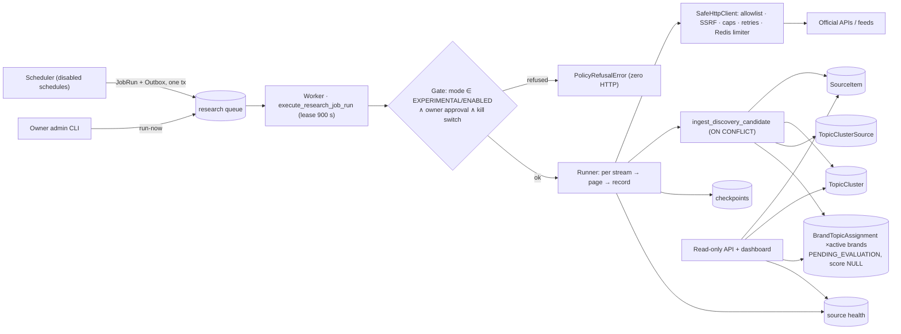

# Phase 5 Implementation — Research Ingestion & Source Connectors

**Status:** ✅ Complete and deployed (2026-11-13). All five first-cohort sources are implemented,
tested, and live-verified. **Every source is `OFF` and every schedule disabled in the runtime until
the owner enables them.**
**Detailed engineering log:** `docs/PHASE_5_COMPLETION_PLAN.md` (milestones, as-built notes, evidence).
**Data-integrity incident and cleanup proposal:** `docs/PHASE_5_STAGE1_DATA_INTEGRITY.md`.
**Roadmap after Phase 5:** `docs/ROADMAP.md`.

---

## 1. What Phase 5 delivers

Research discovery runs once, globally. Editorial decisions stay per brand:



| Area | Delivered |
|---|---|
| Test safety | Integration tests refuse the runtime DB/Redis; disposable tmpfs stack via `scripts/run_integration_tests.py` |
| Schema (migration `0005`) | `research_sources` (policy, approval, config, health, backoff; Reddit locked `BLOCKED` by CHECK), `research_source_checkpoints`, global schedules (nullable `brand_profile_id`) |
| HTTP layer | HTTPS-only exact-host allowlist, SSRF checks per hop (DNS and connected peer), manual bounded redirects, timeouts, byte caps, `trust_env=False`, conditional GET, scoped bearer token |
| Rate limiting | Redis minimum-interval limiter per source, fails closed on Redis outage |
| Retries | In-run ≤ 3 attempts with full-jitter backoff; `Retry-After` ≤ 60 s honoured, longer waits become per-source backoff; errors mapped onto the job ledger's retryable/permanent classes |
| Runner | Gate before HTTP; page + checkpoint in one transaction; per-record savepoints; per-stream isolation; run-level health (`HEALTHY` / `DEGRADED` / `FAILING` + backoff) |
| Ingestion | Concurrency-safe (`INSERT … ON CONFLICT DO NOTHING`); invariants unchanged |
| Connectors | Hacker News, arXiv, OpenAI News, GitHub, Hugging Face (§2) |
| Scheduling | Per-source jobs on the `research` queue; dedicated Celery task (780/840 s limits); 5 schedules seeded disabled |
| Owner control | `python -m media_os_api.research.admin status · set-mode · approve-live · revoke-live · schedule · run-now` (audited; Reddit refused) |
| UI / API | `GET /api/v1/research/sources`, `/research/items`, `/topics?brand=`, `/topics/{id}?brand=`; Research and Topics dashboard pages |
| Payload hygiene | Fetch jobs carry no content; manual-ingest payloads are sanitised and scrubbed after success |

## 2. Connectors

| Source | Official endpoint | Incremental mechanism | Spacing | Live check (disposable DB) |
|---|---|---|---|---|
| Hacker News | `hacker-news.firebaseio.com/v0/{top,new,best}stories.json`, `/v0/item/{id}.json` | seen-id window | ≥ 250 ms | ✅ 2026-11-13 16:34Z — 6 req, 5 stories |
| arXiv | `export.arxiv.org/api/query` (Atom, `defusedxml`) | per-category `published` high-water | ≥ 3.1 s | ✅ 18:08Z — 1 req, 5 papers |
| OpenAI News | `openai.com/news/rss.xml` | ETag/Last-Modified + seen window | ≥ 1 s | ✅ 18:48Z — 1 req, 5 items |
| GitHub | `api.github.com/search/repositories`, `/repos/{o}/{r}/releases` | seen window + per-repo ETag | ≥ 6.5 s | ✅ 19:00Z — 1 req, 5 repos (no token) |
| Hugging Face | `huggingface.co/api/{models,datasets,spaces}` | seen window | ≥ 1 s | ✅ 19:06Z — 1 req, 5 models |
| Reddit | — | — | — | **BLOCKED** (code, DB CHECK, admin CLI) |

Evidence JSON for every live check is under `docs/evidence/`. No model weights, datasets, PDFs,
repository archives or release assets are ever downloaded.

## 3. Verification

| Gate | Result at completion |
|---|---|
| Python unit tests | 218 passed |
| Integration tests (disposable stack) | 64 passed, 2 skipped (opt-in live-runtime tests) |
| Web | `tsc`, eslint, Vitest 9 passed, production build via the web Dockerfile |
| Static | ruff, ruff format, mypy --strict, secret scan, reference manifests (pre-commit on every commit) |
| Live | Owner-approved bounded smoke test per connector (§2); runtime DB untouched each time |

## 4. Runtime state after deployment

- Schema `0005_research_source_registry` (applied 2026-11-13 16:10Z with owner approval).
- API, worker and scheduler run the Phase 5 code (images rebuilt from `main`; rollback tags
  `rollback-pre-phase5` and `rollback-pre-m6` kept).
- Worker consumes `control, maintenance, default, research` at concurrency 1.
- `RESEARCH_LIVE_FETCH_ENABLED=false`; no GitHub token; all sources `OFF`; all schedules disabled.

### Enabling a source (owner decision)

```bash
docker exec media-os-api python -m media_os_api.research.admin set-mode --source HACKERNEWS --mode EXPERIMENTAL
docker exec media-os-api python -m media_os_api.research.admin approve-live --source HACKERNEWS --approver owner
docker exec media-os-api python -m media_os_api.research.admin schedule --source HACKERNEWS --enable
# and set RESEARCH_LIVE_FETCH_ENABLED=true in the runtime .env, then recreate the worker
```

## 5. Known limitations and follow-ups

| Item | Where it is handled |
|---|---|
| Fixture rows left in the runtime DB by the 2026-11-13 test-suite reset | Cleanup proposal awaiting owner decision (`PHASE_5_STAGE1_DATA_INTEGRITY.md`) |
| Source metrics (HN score, stars, likes) are parsed but not persisted (`SourceItem` has no metrics column) | Decide storage before Phase 6 ranking |
| GitHub `sort=stars` favours established repositories | Add a `created:>` new-repo query mode (T1) |
| OpenAI feed mixes customer case studies with announcements | De-prioritise in Phase 6 scoring (T1) |
| Hugging Face trending can include uncensored/NSFW models | Brand-safety filter in Phase 6 (T1) |
| arXiv abstract excerpts (≤ 500 chars) stored | ✅ Owner approved 2026-11-14: arXiv API Terms of Use license descriptive metadata incl. abstracts under CC0 1.0 |
| Two concurrent runs of one source are safe but not serialised | Acceptable; scheduled runs are de-duplicated per slot |
| Explicit CHECK constraint names are double-prefixed (pre-existing since 0001) | Cosmetic; rename migration if ever needed |
| Brands activated after a cluster exists get no assignment for it | Revisit with Phase 6 editorial evaluation |
