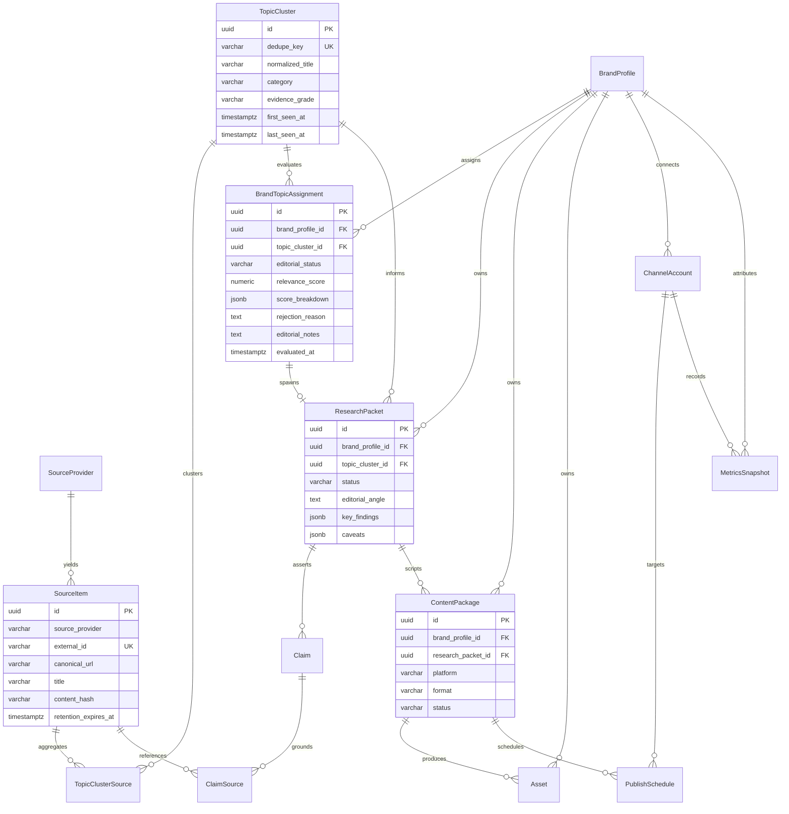

# MEDIA INTELLIGENCE OS — PRE-PHASE 5 TECHNICAL AUDIT
## Pre-Commit Reliability & Shared Research / Multi-Brand Database Architecture

**Audit Date:** 2026-11-11
**Auditor:** Principal Software Architect, Senior Python Tooling Engineer & Data Architect
**Repository:** `C:\Media OS Agent\media-intelligence-os`
**Target File:** `docs/PRE_PHASE_5_ARCHITECTURE_AUDIT.md`
**Status:** AUDIT COMPLETE — AWAITING REVIEW & AUTHORIZATION

---

## SECTION A — REPOSITORY AND ENVIRONMENT STATE

### A.1 Git Repository Verification
- **Branch:** `main`
- **Expected Checkpoint:** `68aa2ea` (`phase4: harden rotate_password CLI, fix compose test env leak, add unit tests`)
- **Actual HEAD Commit:** `179736e83dc1a7ec84731b2cd25dac586a545072` (`docs(phase4): update SEC-01 verification evidence with rotate_password unit test`)
- **Difference from Expected:** Exactly 1 commit ahead of `68aa2ea`. The diff (`git show 179736e`) is strictly documentation updating traceability evidence in `docs/REQUIREMENTS_TRACEABILITY.md` (1 line inserted, 1 line deleted). No application code or database schema changed between `68aa2ea` and `179736e`.
- **Working Tree:** Clean (`git status`: `nothing to commit, working tree clean`).
- **Git Hook Path:** Default (`core.hooksPath` unset; resolves to `.git/hooks/pre-commit`).

### A.2 Local Tooling & Runtime Environment
- **Operating System:** Windows 11 Enterprise (`win32` / PowerShell 7+)
- **System Global Python:** Python `3.14.6` (`C:\Python314\python.exe`)
- **Virtual Environment Location:** `C:\Media OS Agent\media-intelligence-os\.venv`
- **Project Python Interpreter:** Python `3.12.9` (`.venv\Scripts\python.exe`)
- **Package Manager / Environment Manager:** `uv 0.10.9` (f675560f3 2026-03-06)
- **Pre-Commit Version:** `4.7.0` (installed in `.venv`)
- **Ruff Version:** `0.17.4` (installed in `.venv`)
- **MyPy Version:** `2.4.1` (compiled: yes, installed in `.venv`)
- **Pytest Version:** `9.2.0` (all 21 unit tests pass in 4.99s)
- **Global System PATH:** Does NOT contain `.venv\Scripts`. Executables `ruff`, `mypy`, and `pre-commit` are NOT on global `PATH` (`where.exe ruff` -> `INFO: Could not find files for the given pattern(s)`).

### A.3 Docker Infrastructure & Service Health
All 14 Docker containers across the Media OS application stack and independent Postiz stack are running and healthy:

| Container Name | Image | Status | Ports / Exposure | Role |
|---|---|---|---|---|
| `media-os-web` | `media-intelligence-os-web:phase4` | Up (healthy) | `127.0.0.1:3000->3000/tcp` | Standalone Next.js Dashboard |
| `media-os-api` | `media-intelligence-os-api:phase4` | Up (healthy) | `127.0.0.1:8000->8000/tcp` | FastAPI Control Plane |
| `media-os-worker` | `media-intelligence-os-api:phase4` | Up (healthy) | Internal (Celery) | Celery Background Worker |
| `media-os-scheduler` | `media-intelligence-os-api:phase4` | Up (healthy) | Internal (Outbox/Scheduler) | Outbox & Schedule Dispatcher |
| `media-os-postgres` | `postgres:17-alpine` | Up (healthy) | Internal `5432/tcp` | Media OS Primary PostgreSQL |
| `media-os-redis` | `redis:7.2` | Up (healthy) | Internal `6379/tcp` | Celery Broker & Rate Limiting |
| `postiz-runtime-app` | `ghcr.io/gitroomhq/postiz-app:v2.25.3` | Up (healthy) | `127.0.0.1:4007->5000/tcp` | Independent Postiz Service |
| `postiz-runtime-postgres` | `postgres:17-alpine` | Up (healthy) | Internal `5432/tcp` | Postiz Application Database |
| `postiz-runtime-redis` | `redis:7.2` | Up (healthy) | Internal `6379/tcp` | Postiz Cache/Broker |
| `postiz-runtime-temporal` | `temporalio/auto-setup:1.28.1` | Up (healthy) | Internal Temporal ports | Postiz Workflow Engine |
| `postiz-runtime-temporal-admin-tools` | `temporalio/admin-tools:1.28.1...` | Up | Internal | Temporal CLI Tools |
| `postiz-runtime-temporal-ui` | `temporalio/ui:2.34.0` | Up (healthy) | Internal `8080/tcp` | Temporal UI |
| `postiz-runtime-temporal-postgres` | `postgres:16` | Up (healthy) | Internal `5432/tcp` | Temporal Database |
| `postiz-runtime-temporal-elasticsearch`| `elasticsearch:7.17.27` | Up (healthy) | Internal `9200/tcp` | Temporal Search Attributes |

### A.4 Live Service Endpoints Verified
- `GET http://127.0.0.1:8000/health/live`: `{"status":"ok","service":"media-os-api","phase":"phase-4-persistence","environment":"production"}`
- `GET http://127.0.0.1:8000/health/ready`: `{"status":"ready","database":"PostgreSQL healthy (schema=0003_domain_integrity_hardening)","redis":"Redis reachable (PING -> PONG)"}`
- `GET http://127.0.0.1:3000`: `307 Temporary Redirect` -> `/login`
- `GET http://127.0.0.1:4007`: `307 Temporary Redirect` -> `/auth` (Postiz)

---

## SECTION B — ISSUE A: PRE-COMMIT TOOLING RELIABILITY AUDIT

### B.1 Existing Hook Architecture
The repository's [.pre-commit-config.yaml](file:///C:/Media%20OS%20Agent/media-intelligence-os/.pre-commit-config.yaml) defines two categories of hooks:
1. **Upstream Pre-Commit Hooks:**
   - `trailing-whitespace`, `end-of-file-fixer`, `check-yaml`, `check-toml`, `check-added-large-files`, `detect-private-key` (from `pre-commit/pre-commit-hooks:v5.0.0`).
2. **Local Python Hooks (`repo: local`):**
   ```yaml
     - repo: local
       hooks:
         - id: ruff-format
           name: ruff format check
           entry: ruff format --check
           language: system
           types: [python]
         - id: ruff-lint
           name: ruff lint
           entry: ruff check
           language: system
           types: [python]
         - id: mypy
           name: mypy type check
           entry: mypy
           language: system
           pass_filenames: false
         - id: scan-secrets
           name: scan repository for secrets
           entry: python scripts/scan_secrets.py
           language: system
           pass_filenames: false
   ```

### B.2 Exact Root Cause Analysis
1. **`language: system` Behavior:**
   In pre-commit, `language: system` instructs pre-commit to execute the entry binary directly by resolving it via the process's inherited environment variable `PATH`. Pre-commit creates no virtual environment and performs zero PATH modifications.
2. **Git Hook Execution Context:**
   When `git commit` is invoked, Git executes `.git/hooks/pre-commit` (a POSIX shell script executed by Git's embedded `sh.exe`). Although `.git/hooks/pre-commit` correctly specifies `INSTALL_PYTHON='C:\Media OS Agent\media-intelligence-os\.venv\Scripts\python.exe'` and invokes `"$INSTALL_PYTHON" -mpre_commit`, it does **not** prepend `C:\Media OS Agent\media-intelligence-os\.venv\Scripts` to `PATH`.
3. **Environment Asymmetry:**
   On Windows workstations, IDEs, and subshell environments (such as Antigravity or a fresh PowerShell window), `.venv\Scripts` is not automatically in `PATH`. Consequently:
   - When pre-commit runs `entry: ruff format --check`, Windows looks up `ruff.exe` in system `PATH` and fails with `Executable 'ruff' not found`.
   - When pre-commit runs `entry: mypy`, it fails with `Executable 'mypy' not found`.
   - When pre-commit runs `entry: python scripts/scan_secrets.py`, it resolves to `C:\Python314\python.exe` (host Python 3.14.6) rather than the project's pinned Python 3.12.9 virtual environment.
4. **Previous Workaround:**
   Because local commits failed with `Executable 'ruff' not found`, developers/agents bypassed the hook using `git commit --no-verify`. This broke the automated enforcement gate.

### B.3 Reproduced Failures (Clean PowerShell Environment)
We executed the verification sequence from a clean PowerShell session without `.venv` activated:

```powershell
cd "C:\Media OS Agent\media-intelligence-os"
pre-commit --version
.\.venv\Scripts\ruff.exe --version
.\.venv\Scripts\mypy.exe --version
.\.venv\Scripts\pre-commit.exe run --all-files
```

**Reproduced Output:**
```text
pre-commit : The term 'pre-commit' is not recognized as the name of a cmdlet, function, script file, or operable program.
At line:1 char:168

ruff 0.17.4
mypy 2.4.1 (compiled: yes)

trim trailing whitespace.................................................Passed
fix end of files.........................................................Passed
check yaml...............................................................Passed
check toml...............................................................Passed
check for added large files..............................................Passed
detect private key.......................................................Passed
ruff format check........................................................Failed
- hook id: ruff-format
- exit code: 1

Executable `ruff` not found

ruff lint................................................................Failed
- hook id: ruff-lint
- exit code: 1

Executable `ruff` not found

mypy type check..........................................................Failed
- hook id: mypy
- exit code: 1

Executable `mypy` not found

scan repository for secrets..............................................Passed
```

### B.4 Actual Git Hook Execution in Isolated Disposable Repository
To test whether `git commit` invokes pre-commit and whether failures reject commits, we created an isolated temporary Git repository (`$env:TEMP\test_git_hook_...`) and staged files:
- **Result:** Pre-commit was invoked by Git during `git commit`, but failed with `Executable 'ruff' not found` and `Executable 'mypy' not found`, rejecting the commit with exit code `1`.
- **Conclusion:** Git hook invocation works, but fails at runtime due to executable path resolution under `language: system`.

### B.5 Evaluation of Remediation Approaches

#### Option A: Isolated Pre-Commit Environments (`astral-sh/ruff-pre-commit` & `mirrors-mypy`)
- **Ruff:** Using `repo: https://github.com/astral-sh/ruff-pre-commit` (rev `v0.17.4`) works cleanly because Ruff is a self-contained Rust binary without dependencies.
- **MyPy:** Using `repo: https://github.com/pre-commit/mirrors-mypy` **fails catastrophically**.
  - **Empirical Test:** We ran MyPy without the project virtual environment (`mypy --no-site-packages`). It emitted **164 errors across 42 files** because strict type checking requires Pydantic, FastAPI, SQLAlchemy, Celery, Redis, and Argon2 type stubs.
  - To make `mirrors-mypy` work, all 20+ project dependencies from `pyproject.toml` would need to be manually duplicated inside `.pre-commit-config.yaml` under `additional_dependencies: [...]`. This duplicates maintenance, slows hook caching down by minutes, and constantly drifts out of sync.

#### Option B: Environment Dispatcher / Runner (`scripts/run_in_env.py`)
- Introduce a lightweight, zero-dependency dispatcher script `scripts/run_in_env.py`.
- **How it Works:**
  1. Inspects the repository root for `.venv/Scripts` (Windows) or `.venv/bin` (Linux/macOS).
  2. If the executable (`<tool>.exe` or `<tool>`) exists in `.venv`, executes it using `subprocess.run()`.
  3. If not in `.venv` (e.g. in GitHub Actions CI where tools are installed in the global runner Python), falls back to `shutil.which(tool)`.
  4. If neither exists, prints a clear error and exits with code 1.
- **Empirical Test:**
  - We verified this dispatcher in an isolated temporary Git repository:
    - Clean code committed successfully (`exit code: 0`).
    - Unformatted Python code was detected and failed (`exit code: 1`).
    - Python syntax error was detected and rejected the commit (`exit code: 2`).
  - Works identically on Windows PowerShell, Antigravity terminal, fresh terminals, and Linux CI.

#### Option C: Git Hook PATH Injection (`.git/hooks/pre-commit`)
- Modifying `.git/hooks/pre-commit` to prepend `dirname "$INSTALL_PYTHON"` to `PATH`.
- **Verdict:** Fragile. Any execution of `pre-commit install` overwrites the hook file with pre-commit's default template. Furthermore, it does not fix manual invocations of `pre-commit run --all-files`.

### B.6 Comparison Table

| Check | Existing Configuration | Reproduced Failure | Recommended Correction | Verification Method |
|---|---|---|---|---|
| **Ruff Format** | `entry: ruff format --check` (`language: system`) | `Executable 'ruff' not found` | `entry: python scripts/run_in_env.py ruff format --check` | Run from unactivated PowerShell; commit unformatted code in test repo |
| **Ruff Lint** | `entry: ruff check` (`language: system`) | `Executable 'ruff' not found` | `entry: python scripts/run_in_env.py ruff check` | Commit code with unused imports; verify rejection |
| **MyPy Strict** | `entry: mypy` (`language: system`) | `Executable 'mypy' not found` | `entry: python scripts/run_in_env.py mypy` | Run without activation; verify all 20+ dependencies resolve cleanly |
| **Secret Scan** | `entry: python scripts/scan_secrets.py` (`language: system`) | Runs on host Python 3.14.6 instead of project 3.12.9 | `entry: python scripts/run_in_env.py python scripts/scan_secrets.py` | Verify Python 3.12 executes scan script |
| **Ref Manifest** | Completely missing from pre-commit | Not checked locally (only runs in CI) | Add hook: `entry: python scripts/run_in_env.py python scripts/generate_ref_manifests.py --verify` | Verify unmodified reference repo passes; altered file fails |

### B.7 CI Parity Analysis
- In [.github/workflows/ci.yml](file:///C:/Media%20OS Agent/media-intelligence-os/.github/workflows/ci.yml), CI executes:
  - `ruff format --check .`
  - `ruff check .`
  - `mypy`
  - `python scripts/scan_secrets.py`
  - `python scripts/generate_ref_manifests.py --verify`
  - `pytest tests/unit`
  - `alembic upgrade head && pytest tests/integration`
  - `pytest tests/smoke`
- **Gaps Identified:**
  1. `generate_ref_manifests.py --verify` was present in CI but absent in `.pre-commit-config.yaml`.
  2. Local pre-commit used `types: [python]` for `ruff-format` and `ruff-lint`, which checks staged files, whereas CI checks the entire repository (`.`). Local hooks should retain staged file filtering for format/lint, but full-repo checks (`pass_filenames: false`) for type checking, secrets, and manifest verification.

### B.8 Recommended Configuration Patch (For Future Implementation)

#### Proposed File 1: `scripts/run_in_env.py`
```python
"""Cross-platform executable dispatcher for pre-commit hooks and local tooling."""

from __future__ import annotations

import os
import shutil
import subprocess
import sys
from pathlib import Path


def main() -> None:
    if len(sys.argv) < 2:
        print("Usage: run_in_env.py <tool_name> [args...]", file=sys.stderr)
        sys.exit(1)

    tool = sys.argv[1]
    args = sys.argv[2:]

    repo_root = Path(__file__).resolve().parent.parent

    # Candidate binary paths inside local virtualenv
    candidates: list[Path] = []
    if sys.platform == "win32":
        candidates.append(repo_root / ".venv" / "Scripts" / f"{tool}.exe")
        candidates.append(repo_root / ".venv" / "Scripts" / f"{tool}.bat")
    else:
        candidates.append(repo_root / ".venv" / "bin" / tool)

    # 1. Attempt execution from local .venv
    for candidate in candidates:
        if candidate.is_file():
            res = subprocess.run([str(candidate), *args], check=False)
            sys.exit(res.returncode)

    # Special handling when tool is 'python'
    if tool == "python":
        py_cand = (
            repo_root / ".venv" / "Scripts" / "python.exe"
            if sys.platform == "win32"
            else repo_root / ".venv" / "bin" / "python"
        )
        if py_cand.is_file():
            res = subprocess.run([str(py_cand), *args], check=False)
            sys.exit(res.returncode)

    # 2. Fallback to system PATH (e.g. GitHub Actions CI runners)
    which_path = shutil.which(tool)
    if which_path:
        res = subprocess.run([which_path, *args], check=False)
        sys.exit(res.returncode)

    print(
        f"Error: Executable '{tool}' not found in project .venv or system PATH.\n"
        f"Did you run: uv venv .venv --python 3.12 && uv pip install -e \".[dev]\"?",
        file=sys.stderr,
    )
    sys.exit(1)


if __name__ == "__main__":
    main()
```

#### Proposed File 2: `.pre-commit-config.yaml`
```yaml
repos:
  - repo: https://github.com/pre-commit/pre-commit-hooks
    rev: v5.0.0
    hooks:
      - id: trailing-whitespace
      - id: end-of-file-fixer
      - id: check-yaml
      - id: check-toml
      - id: check-added-large-files
        args: ["--maxkb=512"]
      - id: detect-private-key

  - repo: local
    hooks:
      - id: ruff-format
        name: ruff format check
        entry: python scripts/run_in_env.py ruff format --check
        language: system
        types: [python]
      - id: ruff-lint
        name: ruff lint
        entry: python scripts/run_in_env.py ruff check
        language: system
        types: [python]
      - id: mypy
        name: mypy type check
        entry: python scripts/run_in_env.py mypy
        language: system
        pass_filenames: false
      - id: scan-secrets
        name: scan repository for secrets
        entry: python scripts/run_in_env.py python scripts/scan_secrets.py
        language: system
        pass_filenames: false
      - id: verify-ref-manifests
        name: verify reference repository manifests
        entry: python scripts/run_in_env.py python scripts/generate_ref_manifests.py --verify
        language: system
        pass_filenames: false
```

---

## SECTION C — ISSUE B: DATABASE SCHEMA & MODEL AUDIT

### C.1 Introspected Database Schema vs SQLAlchemy Models
We performed live SQL introspection against the running `media-os-postgres` container (`media_os` database, Alembic revision `0003_domain_integrity_hardening`) and cross-checked against [models.py](file:///C:/Media%20OS%20Agent/media-intelligence-os/apps/api/src/media_os_api/db/models.py).

#### 1. Table `source_items`
- **Columns:**
  - `id`: UUID (PK, not null)
  - `source_provider`: varchar(64) not null
  - `external_id`: varchar(255) not null
  - `canonical_url`: varchar(2048) not null
  - `title`: varchar(512) not null
  - `source_label`: varchar(128) not null
  - `published_at`: timestamptz nullable
  - `event_at`: timestamptz nullable
  - `fetched_at`: timestamptz not null default `now()`
  - `content_hash`: varchar(64) not null
  - `minimal_permitted_summary`: text nullable
  - `source_policy_mode`: varchar(32) not null default `'OFF'`
  - `retention_expires_at`: timestamptz not null
  - `terms_checked_at`: timestamptz nullable
  - `created_at` / `updated_at`: timestamptz not null default `now()`
- **Constraints & Indexes:**
  - `uq_source_items_provider_external_id`: UNIQUE (`source_provider`, `external_id`)
  - `ck_source_items_source_policy_mode_valid`: CHECK mode IN (`'OFF'`, `'EXPERIMENTAL'`, `'ENABLED'`, `'BLOCKED'`)
  - Indexes on `canonical_url`, `content_hash`, `retention_expires_at`
- **Brand Scoping:** **NONE.** There is **NO `brand_profile_id`** column on `source_items`.

#### 2. Table `topic_clusters`
- **Columns:**
  - `id`: UUID (PK, not null)
  - `normalized_title`: varchar(512) not null
  - `dedupe_key`: varchar(128) not null unique
  - `category`: varchar(128) not null
  - `status`: varchar(32) not null default `'DISCOVERED'`
  - `score_breakdown`: JSONB not null default `'{}'`
  - `scoring_version`: varchar(32) not null default `'v0'`
  - `evidence_grade`: varchar(32) not null default `'UNGRADED'`
  - `first_seen_at` / `last_seen_at`: timestamptz not null default `now()`
  - `created_at` / `updated_at`: timestamptz not null default `now()`
- **Constraints & Indexes:**
  - `uq_topic_clusters_dedupe_key`: UNIQUE (`dedupe_key`)
  - Indexes on `(status, last_seen_at)`, `category`
- **Brand Scoping:** **NONE.** There is **NO `brand_profile_id`** column on `topic_clusters`.

#### 3. Table `topic_cluster_sources`
- **Columns:**
  - `topic_cluster_id`: UUID (PK, FK to `topic_clusters.id` ON DELETE CASCADE)
  - `source_item_id`: UUID (PK, FK to `source_items.id` ON DELETE CASCADE)
  - `created_at`: timestamptz not null default `now()`
- **Brand Scoping:** **NONE.** Pure M:N association between shared topics and shared sources.

#### 4. Table `research_packets`
- **Columns:**
  - `id`: UUID (PK, not null)
  - `brand_profile_id`: UUID not null (FK to `brand_profiles.id` ON DELETE RESTRICT)
  - `topic_cluster_id`: UUID not null (FK to `topic_clusters.id` ON DELETE RESTRICT)
  - `status`: varchar(32) not null default `'DRAFT'`
  - `editorial_angle`: text not null
  - `key_findings`: JSONB not null default `'[]'`
  - `caveats`: JSONB not null default `'[]'`
  - `unresolved_questions`: JSONB not null default `'[]'`
  - `source_manifest`: JSONB not null default `'[]'`
  - `prompt_version`: varchar(64) not null default `'phase4-contract'`
  - `created_at` / `updated_at`: timestamptz not null default `now()`
- **Constraints & Indexes:**
  - `uq_research_packets_id_brand`: UNIQUE (`id`, `brand_profile_id`)
  - Indexes on `(brand_profile_id, status)`, `topic_cluster_id`
- **Cardinality:** Multiple `research_packets` **can point to the same `topic_cluster_id`**. There is NO unique constraint on `topic_cluster_id` or `(brand_profile_id, topic_cluster_id)`.

#### 5. Table `content_packages`
- **Columns:**
  - `id`: UUID (PK, not null)
  - `brand_profile_id`: UUID not null (FK to `brand_profiles.id` ON DELETE RESTRICT)
  - `research_packet_id`: UUID nullable
  - `platform`: varchar(32) not null (`INSTAGRAM`, `YOUTUBE`)
  - `format`: varchar(32) not null
  - `status`: varchar(32) not null default `'DISCOVERED'`
- **Composite Foreign Key:**
  - `fk_content_packages_packet_brand`: FOREIGN KEY (`research_packet_id`, `brand_profile_id`) REFERENCES `research_packets(id, brand_profile_id)` ON DELETE RESTRICT.
  - Trigger `trg_content_packages_brand_immutable`: Blocks updating `brand_profile_id`.

#### 6. Live Row Counts (Audited from PostgreSQL)
| Table Name | Row Count | Nature of Data |
|---|---|---|
| `alembic_version` | 1 | Schema tracking (`0003_domain_integrity_hardening`) |
| `owner_users` | 1 | Seeded local owner user |
| `brand_profiles` | 2 | Seeded initial brands (`brand-tech-ai`, `brand-app-promo`) |
| `audit_events` | 2 | Startup bootstrap audit events |
| `source_items` | 0 | Unpopulated (Phase 5 discovery not yet started) |
| `topic_clusters` | 0 | Unpopulated |
| `topic_cluster_sources` | 0 | Unpopulated |
| `research_packets` | 0 | Unpopulated |
| `claims` | 0 | Unpopulated |
| `claim_sources` | 0 | Unpopulated |
| `content_packages` | 0 | Unpopulated |
| `content_state_transitions` | 0 | Unpopulated |
| `assets` | 0 | Unpopulated |
| `channel_accounts` | 0 | Zero fabricated channels |
| `publish_schedules` | 0 | Unpopulated |
| `metrics_snapshots` | 0 | Unpopulated |
| `model_usages` | 0 | Unpopulated |
| `job_runs` | 0 | Unpopulated |
| `outbox_events` | 0 | Unpopulated |

---

## SECTION D — SHARED RESEARCH ARCHITECTURE ASSESSMENT

### D.1 Relationship Matrix

| Entity | Shared or Brand-Specific? | Current Schema Behavior | Required Product Behavior | Architectural Gap |
|---|---|---|---|---|
| **`SourceItem`** | **Shared** | Globally unique on `(source_provider, external_id)`; no brand FK. | Exactly one canonical record per external source event. | **None.** Already correctly shared. |
| **`TopicCluster`** | **Shared** | Globally unique on `dedupe_key`; no brand FK. Contains shared `category`, `evidence_grade`, `status`, and `score_breakdown`. | Shared deduplicated event grouping multiple sources. | **Partial Gap:** `status` and `score_breakdown` are modeled globally on the cluster itself rather than per brand. |
| **`TopicClusterSource`** | **Shared** | M:N association table linking `topic_cluster_id` and `source_item_id`. | Preserves provenance across sources and topics. | **None.** Correctly normalized. |
| **`BrandTopicAssignment`** | **Brand-Specific** | **DOES NOT EXIST.** | Independent per-brand editorial decision, relevance score, shortlist/rejection status, and notes prior to research. | **CRITICAL GAP:** No entity exists to store Brand 1 vs Brand 2 relevance/decisions without mutating shared cluster. |
| **`ResearchPacket`** | **Brand-Specific** | Foreign key to `brand_profile_id` and `topic_cluster_id`. | Independent research dossier with brand-specific editorial angle and claims. | **None.** Supports multiple brands referencing the same topic cluster. |
| **`Claim` / `ClaimSource`** | **Research-Packet-Specific** | `claims` owned by `research_packet_id`; `claim_sources` grounds claims in shared `source_items`. | Evidence-linked factual claims grounded in canonical sources. | **None.** Trigger enforces grounding on verification. |
| **`ContentPackage`** | **Brand-Specific** | Mandatory `brand_profile_id`; composite FK `(research_packet_id, brand_profile_id)`. | Independent production package with brand-specific voice, hooks, scripts, and slides. | **None.** Physically guarded against cross-brand leaks. |
| **`Asset`** | **Brand-Specific** | Mandatory `brand_profile_id`; composite FK to `content_packages`. | Visual assets (carousels, videos, audio) belonging to one brand. | **None.** Protected by composite FK and logo trigger. |
| **`PublishSchedule`** | **Brand-Specific** | Mandatory `brand_profile_id`; composite FK to `channel_accounts` and `content_packages`. | Scheduling posts to brand-specific connected channel accounts. | **None.** Protected by composite FK. |
| **`MetricsSnapshot`** | **Brand-Specific** | Mandatory `brand_profile_id`; composite FK to `channel_accounts` and `content_packages`. | Performance telemetry attributed to specific brand channel. | **None.** Protected by composite FK. |

### D.2 Walkthrough: One Source Item Serving Multiple Brands
Consider an external discovery: A new open-source agent framework is released on GitHub (`deepseek-ai/test-repo`).

1. **Ingestion (Shared Worker):**
   - The Phase 5 research worker queries the GitHub Releases API.
   - It hashes the release URL and payload, inserting **one canonical row** into `source_items`:
     - `source_provider`: `'GITHUB'`
     - `external_id`: `'deepseek-ai/test-repo'`
     - `canonical_url`: `'https://github.com/deepseek-ai/test-repo'`
     - `content_hash`: `'sha256:...'`
   - If the worker runs again or another job discovers the same release, PostgreSQL's `uq_source_items_provider_external_id` deduplicates it without error.
2. **Clustering (Shared Worker):**
   - The story is clustered into `topic_clusters` with `dedupe_key = 'dedupe:github:deepseek-ai:test-repo'`.
   - A link is inserted into `topic_cluster_sources`.
   - The cluster is created **once globally**.
3. **Editorial Evaluation (The Missing Layer in Current Schema):**
   - **Brand 1 (Technology & AI):** Niche is AI/dev tools. Relevance score: `0.94`. Editorial status: `APPROVED_FOR_RESEARCH`.
   - **Brand 2 (App Promotion):** Niche is promoting the owner's app. Relevance score: `0.15`. Editorial status: `REJECTED` ("Not relevant to consumer app features").
   - *Current Schema Deficiency:* Where do these two divergent scores and statuses get stored?
     - If stored in `topic_clusters.score_breakdown` and `topic_clusters.status`, Brand 2's rejection would clobber Brand 1's approval!
     - If stored in `content_packages`, it forces creating full `content_packages` rows for candidate topics that have not even passed editorial screening.
     - **Solution Required:** A dedicated `BrandTopicAssignment` table linking `(brand_profile_id, topic_cluster_id)` with `relevance_score`, `editorial_status`, and `notes`.
4. **Research Compilation (Brand-Specific):**
   - Brand 1 creates `ResearchPacket 1`:
     - `brand_profile_id`: `a70033c4-c9a6-5f8f-9379-2c9da3b74ca8` (Brand 1)
     - `topic_cluster_id`: `22222222-2222-2222-2222-222222222222` (Shared Topic)
     - `editorial_angle`: "Deep technical analysis of sparse attention implementation."
   - If Brand 2 later decides to cover it as a user-facing integration tutorial, Brand 2 creates `ResearchPacket 2`:
     - `brand_profile_id`: `f04bd301-4d87-5a23-9e24-b5c999066de5` (Brand 2)
     - `topic_cluster_id`: `22222222-2222-2222-2222-222222222222` (Shared Topic)
     - `editorial_angle`: "How our mobile app uses local AI models for privacy."
   - Both packets point to the same underlying topic, but preserve separate angles, key findings, and claims.
5. **Content Production (Brand-Specific):**
   - Brand 1 creates a technical carousel; Brand 2 creates a vertical feature reel.
   - Composite foreign keys guarantee Brand 2 cannot attach Brand 1's research packet.

### D.3 Live Database Scenario Verification (Rollback-Only Transaction)
We executed an end-to-end transactional simulation directly on `media-os-postgres` verifying that:
1. One `SourceItem` was inserted.
2. One `TopicCluster` was inserted and linked via `TopicClusterSource`.
3. Two separate `ResearchPacket` rows were inserted for Brand 1 and Brand 2 pointing to the same `topic_cluster_id`.
4. Both packets retained independent editorial fields.
5. Querying by `brand_profile_id` isolated packets completely.
6. Attempting to assign Brand 1's research packet to Brand 2's `ContentPackage` was **rejected by PostgreSQL foreign key `fk_content_packages_packet_brand`** (`SQLSTATE 23503`).
7. Transaction was safely rolled back.

---

## SECTION E — RECOMMENDED TARGET ARCHITECTURE

### E.1 Target Entity-Relationship Diagram



### E.2 Detailed Entity Design: `BrandTopicAssignment`

```sql
CREATE TABLE brand_topic_assignments (
    id UUID PRIMARY KEY DEFAULT gen_random_uuid(),
    brand_profile_id UUID NOT NULL REFERENCES brand_profiles(id) ON DELETE CASCADE,
    topic_cluster_id UUID NOT NULL REFERENCES topic_clusters(id) ON DELETE CASCADE,
    editorial_status VARCHAR(32) NOT NULL DEFAULT 'CONSIDERED',
    relevance_score NUMERIC(5, 4) NOT NULL DEFAULT 0.0000,
    score_breakdown JSONB NOT NULL DEFAULT '{}'::jsonb,
    rejection_reason TEXT,
    editorial_notes TEXT,
    priority INTEGER NOT NULL DEFAULT 0,
    assigned_at TIMESTAMPTZ NOT NULL DEFAULT now(),
    evaluated_at TIMESTAMPTZ,
    created_at TIMESTAMPTZ NOT NULL DEFAULT now(),
    updated_at TIMESTAMPTZ NOT NULL DEFAULT now(),

    CONSTRAINT uq_brand_topic_assignments_brand_topic
        UNIQUE (brand_profile_id, topic_cluster_id),
    CONSTRAINT uq_brand_topic_assignments_id_brand
        UNIQUE (id, brand_profile_id),
    CONSTRAINT ck_brand_topic_assignments_status
        CHECK (editorial_status IN ('CONSIDERED', 'SHORTLISTED', 'APPROVED_FOR_RESEARCH', 'REJECTED', 'EXPIRED')),
    CONSTRAINT ck_brand_topic_assignments_relevance_range
        CHECK (relevance_score >= 0.0000 AND relevance_score <= 1.0000)
);

CREATE INDEX ix_brand_topic_assignments_brand_status
    ON brand_topic_assignments (brand_profile_id, editorial_status);

CREATE INDEX ix_brand_topic_assignments_brand_score
    ON brand_topic_assignments (brand_profile_id, relevance_score DESC);

CREATE INDEX ix_brand_topic_assignments_topic_cluster_id
    ON brand_topic_assignments (topic_cluster_id);
```

### E.3 Benefits of This Target Architecture
1. **Zero Source Duplication:** External source records remain singletons in `source_items`.
2. **Shared Clustering:** Deduplication logic clusters related stories into a single `TopicCluster` across providers.
3. **Independent Brand Editorial Independence:**
   - Brand 1 (Tech & AI) can shortlist and score a topic 0.95.
   - Brand 2 (App Promotion) can independently reject the same topic with reason "Irrelevant to app audience".
   - Neither brand clobbers the other's status or score.
4. **Clean Content Pipeline:** `ContentPackage` instances are created only when research packets are commissioned or approved, keeping `content_packages` unpolluted by pre-editorial candidate noise.
5. **Preserves Phase 4 Guarantees:** Existing composite foreign keys (`fk_content_packages_packet_brand`, `fk_assets_content_brand`, `fk_publish_schedules_content_brand`) remain untouched.

---

## SECTION F — MIGRATION SAFETY PROPOSAL (ADDITIVE & EXPAND-ONLY)

> [!IMPORTANT]
> This is a proposal for future execution. In accordance with audit instructions, **NO migration was applied during this audit**.

### F.1 Schema Modification Plan
1. **Migration Type:** Purely additive expand migration (`0004_add_brand_topic_assignments.py`).
2. **Tables Affected:**
   - Add new table: `brand_topic_assignments`.
   - Modify existing tables: **None.** No columns added or dropped in `source_items`, `topic_clusters`, or `research_packets`.
3. **Data Backfill:** None required. The live `topic_clusters` table contains **0 rows**.
4. **Locking & Downtime Risks:** Zero. Creating a new unpopulated table and indexes requires no exclusive locks on existing populated tables.
5. **Rollback Strategy:**
   - `alembic downgrade -1` cleanly executes `op.drop_table('brand_topic_assignments')`.
   - Reversible without any data loss.

---

## SECTION G — CROSS-CUTTING ARCHITECTURE QUESTIONS (PART 5)

| # | Question | Verified Audit Finding |
|---|---|---|
| **1** | Does the existing schema support shared source ingestion? | **YES.** `source_items` has unique constraint `uq_source_items_provider_external_id` and zero brand foreign keys. Ingestion is shared globally. |
| **2** | Can one source record be relevant to two brands? | **YES.** A single canonical `SourceItem` can be referenced by multiple `TopicClusterSource` rows and multiple `ClaimSource` rows across distinct brands' research packets. |
| **3** | Can one topic cluster support two independent brand-specific research packets? | **YES.** Verified live in PostgreSQL. `research_packets.topic_cluster_id` is a non-unique foreign key; Brand 1 and Brand 2 can each instantiate separate packets pointing to the identical topic cluster. |
| **4** | Are relevance decisions currently shared or brand-specific? | **CURRENTLY SHARED (DEFECTIVE).** In the existing schema, `topic_clusters` has only one global `status` column and one `score_breakdown` JSONB column. Setting a status or score for Brand 1 mutates the record globally for Brand 2. |
| **5** | Can topic ranking eventually be performed independently per brand? | **NOT WITHOUT ADDITIVE ENTITY.** Independent per-brand ranking requires `brand_topic_assignments` to store per-brand weights, relevance scores, and rank order. |
| **6** | Will a single source discovery job be able to support both brands? | **YES.** Ingestion connectors fetch external data, normalize URLs, compute hashes, and populate `source_items` and `topic_clusters` without brand context. |
| **7** | Can deduplication operate globally rather than separately per brand? | **YES.** `source_items.external_id` and `topic_clusters.dedupe_key` operate globally, preventing duplicate fetches and duplicate clustering. |
| **8** | Are source-level and brand-level retention policies clearly distinguishable? | **YES.** `source_items.retention_expires_at` purges raw items after 30 days (unless protected by `ClaimSource`), while brand assets, content packages, and metrics retain independent retention policies. |
| **9** | Does the current database schema create unnecessary duplicated ingestion? | **NO.** Ingestion deduplication is fully protected at the schema level by `uq_source_items_provider_external_id`. |
| **10** | Does Phase 5 require a schema change before connector implementation? | **YES for Editorial Ranking (FR-03/FR-05); NO for Raw Connectors (FR-01/FR-02).** Raw connectors write only to `source_items` and `topic_clusters`. However, before Phase 5 implements brand ranking and selection, the additive `brand_topic_assignments` table must be migrated. |
| **11** | Can the source connector contract remain independent of brand context? | **YES.** The connector interface should take provider parameters and return canonical `SourceItem` objects with zero `brand_profile_id` awareness. |
| **12** | What tests are needed to prevent future cross-brand data leakage? | 1. Ingestion deduplication tests confirming a source discovered under multiple runs produces 1 row.<br>2. Editorial isolation tests confirming Brand 1 rejecting a topic does not alter Brand 2's topic view.<br>3. Composite FK enforcement tests verifying cross-brand packet/content links are rejected by PostgreSQL.<br>4. Brand API endpoint scoping tests ensuring `/api/v1/brands/{id}/topics` returns only that brand's assignments. |

---

## SECTION H — PHASE 5 READINESS DECISION & RECOMMENDED ACTION

### H.1 Readiness Assessment Matrix

| Requirement | Status | Verification Summary |
|---|---|---|
| **Pre-commit reliability** | **FAIL** | Fails with `Executable 'ruff' not found` when `.venv\Scripts` is not in system PATH. |
| **Actual Git hook invocation** | **PASS** | Git invokes `.git/hooks/pre-commit`, but execution aborts due to binary path resolution. |
| **CI / local check parity** | **FAIL** | Local pre-commit is missing `generate_ref_manifests.py --verify`, which is required in CI. |
| **Global source deduplication** | **PASS** | Verified live: `source_items` and `topic_clusters` have global unique keys and no brand FKs. |
| **Shared TopicCluster design** | **PASS** | Verified live: `topic_clusters` and `topic_cluster_sources` aggregate sources across providers. |
| **Brand-specific editorial assignment** | **BLOCKED** | Missing `BrandTopicAssignment` entity to store per-brand relevance score and status. |
| **Brand-specific ResearchPackets** | **PASS** | Verified live: independent packets for Brand 1 and Brand 2 can reference the same cluster. |
| **Brand isolation guarantees** | **PASS** | Verified live: PostgreSQL composite FK `fk_content_packages_packet_brand` rejects cross-brand links. |
| **Migration safety** | **PASS** | Tables are empty (0 rows); additive `brand_topic_assignments` migration carries zero risk. |
| **Phase 5 implementation readiness** | **BLOCKED** | Blocked by pre-commit tooling failure and missing editorial assignment schema entity. |

---

### H.2 Final Architectural Outcome

### **OUTCOME 4 — BOTH FIXES REQUIRED**

**Justification:**
1. **Tooling Gate:** The pre-commit Git hook currently fails on standard Windows/PowerShell environments because `ruff` and `mypy` cannot be found on `PATH`. This forced previous development to rely on `git commit --no-verify`, which is unacceptable for Phase 5 development. The cross-platform dispatcher `scripts/run_in_env.py` and updated `.pre-commit-config.yaml` must be applied and verified before starting Phase 5.
2. **Schema Gate:** While `source_items` and `topic_clusters` correctly support shared ingestion, the current schema lacks an entity (`BrandTopicAssignment`) to store per-brand editorial screening, ranking, and selection decisions. Without this table, Phase 5 topic ranking (FR-03) and editorial selection (FR-05) would either overwrite shared cluster data or prematurely pollute `content_packages`. An additive Alembic migration `0004_add_brand_topic_assignments.py` must be reviewed and authorized before Phase 5 connector ranking logic is written.

---
*Report completed and verified against live PostgreSQL metadata, clean Git working tree, and disposable reproduction test environments. No application code or database records were modified.*
