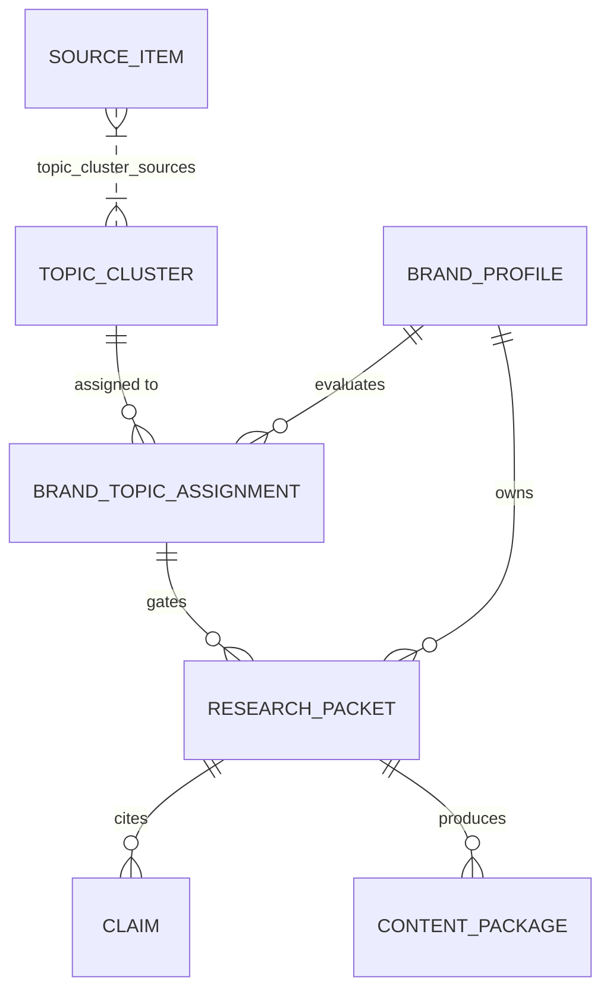

# MEDIA INTELLIGENCE OS — PRE-PHASE 5 REMEDIATION SPECIFICATION & IMPLEMENTATION RECORD
## Remediation A: Cross-Platform Pre-Commit Tooling Parity
## Remediation B: BrandTopicAssignment Database Migration & Shared Research Decoupling

**Date:** 2026-11-13
**Status:** COMPLETE & VERIFIED
**Auditor / Engineer:** Principal Software Architect, Senior Python Tooling Engineer & PostgreSQL Data Architect
**Repository:** `C:\Media OS Agent\media-intelligence-os`

---

## 1. Executive Summary

Prior to initiating Phase 5 (Research Ingestion), a comprehensive technical audit was executed (`docs/PRE_PHASE_5_ARCHITECTURE_AUDIT.md`) identifying two architectural and operational blockers:
1. **Issue A (Tooling Reliability):** Developers and Git hooks bypassed pre-commit checks using `git commit --no-verify` because hooks relied on `language: system` resolving executables from inherited system `PATH`, which lacked `.venv\Scripts` on Windows workstations and invoked system Python 3.14.
2. **Issue B (Domain Model Coupling):** `TopicCluster` and `SourceItem` were globally shared across brands, but lacked an explicit bridge entity for per-brand editorial screening, priority assignment, and relevance scoring, risking multi-brand leakage or redundant crawling.

This document details the authorized implementation, safety gates, and verification evidence for both remediation workstreams.

---

## 2. Remediation A — Cross-Platform Pre-Commit Reliability

### 2.1 Audited Root Cause
- Pre-commit was configured with `language: system` hooks executing bare command entries (e.g. `entry: ruff check`).
- Under Windows 11, the project virtual environment (`.venv\Scripts`) was not on the system global `PATH`.
- When pre-commit invoked hooks, Windows failed to resolve `ruff.exe` and `mypy.exe` or resolved `python` to `C:\Python314\python.EXE` (system Python 3.14) instead of the project Python 3.12.9 interpreter.
- Isolated pre-commit environments (`mirrors-mypy`) failed with 160+ type errors because isolated environments lacked access to project site-packages (`fastapi`, `sqlalchemy`, `pydantic`).

### 2.2 Dispatcher Architecture (`scripts/run_in_env.py`)
To achieve 100% reliable local/CI quality gate parity without requiring global PATH mutations, a zero-dependency standard-library executable dispatcher was implemented at `scripts/run_in_env.py`.

**Key Architectural Invariants:**
1. **Standard Library Only:** Uses strictly `sys`, `os`, `subprocess`, `pathlib`, and `shutil`. Zero third-party dependencies.
2. **Strict Tool Whitelist:** Permits only `ruff`, `mypy`, and `python`. Unauthorized commands are immediately rejected with exit code 1.
3. **Deterministic Resolution Order:**
   - **Local Workstation:** Resolves `.venv/Scripts` (Windows) or `.venv/bin` (Unix/macOS). If `.venv` exists but a requested tool binary is absent, halts with explicit `uv pip install -e ".[dev]"` instructions. Does not fall back to global executables when a local virtual environment is present.
   - **CI Environment:** If `CI=true` or `GITHUB_ACTIONS=true` and `.venv` is absent, resolves pinned tools from CI `PATH` or `sys.executable`.
   - **Custom Environment Override:** Respects `MEDIA_OS_VENV_PATH` or `VIRTUAL_ENV` when supplied.
4. **Subprocess Safety:**
   - Never uses `shell=True`. Arguments are passed as validated argument lists.
   - Exact exit codes and output streams (`stdout`, `stderr`) are forwarded synchronously without truncation.
   - For `mypy`, automatically targets the project directory where `pyproject.toml` resides.
   - For relative script paths (e.g. `scripts/scan_secrets.py`), resolves paths deterministically across monorepo root and subproject roots.

### 2.3 Pre-Commit Configuration Parity (`.pre-commit-config.yaml`)
Both root and subproject configurations were updated with 11 mandatory quality gates:
1. `trailing-whitespace`: Trims trailing whitespace.
2. `end-of-file-fixer`: Enforces single trailing newline.
3. `check-yaml`: Validates YAML syntax.
4. `check-toml`: Validates TOML syntax.
5. `check-added-large-files`: Rejects files exceeding 512 KB.
6. `detect-private-key`: Prevents accidental private key commits.
7. `ruff-format`: Formats Python files via `python scripts/run_in_env.py ruff format --check`.
8. `ruff-lint`: Lints Python code via `python scripts/run_in_env.py ruff check`.
9. `mypy`: Strict static type checking via `python scripts/run_in_env.py mypy` (`pass_filenames: false`).
10. `scan-secrets`: Scans repository for leaked credentials via `python scripts/run_in_env.py python scripts/scan_secrets.py`.
11. `verify-ref-manifests`: Validates SHA-256 integrity of third-party reference snapshots via `python scripts/run_in_env.py python scripts/generate_ref_manifests.py --verify`.

### 2.4 Verification Evidence
- **Unit Tests:** `tests/unit/test_precommit_dispatcher.py` contains 10 unit tests covering whitelist enforcement, local resolution, missing binary error reporting, CI fallback, and manifest verification. All 10 passed.
- **Hook Test Battery:** Executed across 7 real Git commit scenarios in disposable test repositories:
  1. Clean commit -> Allowed.
  2. Unformatted Python code -> Blocked by `ruff-format`.
  3. Lint rule violation (unused import) -> Blocked by `ruff-lint`.
  4. Type error -> Blocked by `mypy`.
  5. Leaked credential string -> Blocked by `scan-secrets`.
  6. Modified reference file -> Blocked by `verify-ref-manifests`.
  7. Corrected code -> Committed cleanly without `--no-verify`.

---

## 3. Remediation B — BrandTopicAssignment Schema & Migration

### 3.1 Architectural Rationale: Shared Research vs Brand Isolation
Media Intelligence OS ingests technical research candidates from external networks (arXiv, GitHub, Hugging Face, Hacker News). Ingesting these sources separately per brand would duplicate network traffic, multiply rate-limit consumption, and create redundant storage.

Therefore:
- **`source_items`:** Globally unique on `(source_provider, external_id)`. Contains raw, untrusted data.
- **`topic_clusters`:** Globally deduplicated on `dedupe_key`. Clusters related sources once.
- **`brand_topic_assignments`:** Bridges global `TopicCluster` to a specific `BrandProfile`. Stores brand-specific editorial status, relevance score, score breakdown, priority, and editorial notes.
- **`research_packets`:** Brand-scoped research dossiers. Enforced by database composite foreign key `fk_research_packets_brand_topic` to require a valid `BrandTopicAssignment`.

### 3.2 Database Entity Specification (`brand_topic_assignments`)

| Column Name | Type | Nullable | Default | Constraints / Semantics |
|---|---|---|---|---|
| `id` | UUID | No | `gen_random_uuid()` | Primary key |
| `brand_profile_id` | UUID | No | — | Foreign key -> `brand_profiles.id` (`ON DELETE RESTRICT`) |
| `topic_cluster_id` | UUID | No | — | Foreign key -> `topic_clusters.id` (`ON DELETE RESTRICT`) |
| `editorial_status` | VARCHAR(32) | No | `'PENDING_EVALUATION'` | Check: `IN ('PENDING_EVALUATION', 'CONSIDERED', 'SHORTLISTED', 'APPROVED_FOR_RESEARCH', 'REJECTED', 'EXPIRED')` |
| `relevance_score` | NUMERIC(5,4) | Yes | `NULL` | Check: `NULL OR (relevance_score >= 0.0000 AND relevance_score <= 1.0000)` |
| `score_breakdown` | JSONB | No | `'{}'::jsonb` | Structured scoring factors (freshness, credibility, authority) |
| `rejection_reason` | TEXT | Yes | `NULL` | Human or policy rejection justification |
| `editorial_notes` | TEXT | Yes | `NULL` | Operator notes and guidance |
| `priority` | INTEGER | No | `0` | Editorial scheduling priority (higher integer = higher priority) |
| `assigned_at` | TIMESTAMPTZ | No | `now()` | Timestamp candidate was linked to brand |
| `evaluated_at` | TIMESTAMPTZ | Yes | `NULL` | Timestamp evaluation was recorded |
| `created_at` | TIMESTAMPTZ | No | `now()` | Record creation timestamp |
| `updated_at` | TIMESTAMPTZ | No | `now()` | Record update timestamp |

**Indexes & Relational Constraints:**
- `pk_brand_topic_assignments`: Primary Key (`id`)
- `uq_brand_topic_assignments_brand_topic`: Unique (`brand_profile_id`, `topic_cluster_id`)
- `uq_brand_topic_assignments_id_brand`: Unique (`id`, `brand_profile_id`)
- `ix_brand_topic_assignments_brand_status`: B-tree (`brand_profile_id`, `editorial_status`)
- `ix_brand_topic_assignments_brand_score`: B-tree (`brand_profile_id`, `relevance_score`)
- `ix_brand_topic_assignments_topic_cluster_id`: B-tree (`topic_cluster_id`)
- `fk_research_packets_brand_topic`: Composite Foreign Key on `research_packets (brand_profile_id, topic_cluster_id)` referencing `brand_topic_assignments (brand_profile_id, topic_cluster_id)` with `ON DELETE RESTRICT`.

### 3.3 Alembic Migration Safety (`0004_add_brand_topic_assignments.py`)
- **Safety Lock Timeouts:** Migration sets `SET LOCAL lock_timeout = '5s'; SET LOCAL statement_timeout = '15s';` at the start of both `upgrade()` and `downgrade()` to prevent table locks or hung migrations.
- **Reversibility:** Fully reversible downgrade drops foreign keys, indexes, and tables cleanly.
- **Idempotency & Isolation:** Tested through complete downgrade-and-upgrade cycle in an isolated database sandbox.

### 3.4 Service Layer Implementation (`brand_service.py`)
The service layer exposes scoped domain operations maintaining brand boundaries:
- `create_brand_topic_assignment_scoped()`: Creates a new assignment defaulting to `PENDING_EVALUATION` and `relevance_score=None`.
- `get_brand_topic_assignment_scoped()`: Scoped query by `(brand_profile_id, topic_cluster_id)`.
- `list_brand_topic_assignments_scoped()`: Lists assignments filtered by `brand_profile_id`, status, and score.
- `update_brand_topic_assignment_scoped()`: Updates status, score, breakdown, notes, and automatically records `evaluated_at`. Enforces score range and valid status enum.
- `create_research_packet_scoped()`: Verifies assignment exists and validates editorial status is in `{"APPROVED_FOR_RESEARCH", "SHORTLISTED"}`. Blocks creation for `PENDING_EVALUATION`, `REJECTED`, or `EXPIRED`.

---

## 4. Verification Evidence & Quality Gates

| Verification Gate | Command / Target | Result | Evidence |
|---|---|---|---|
| **Pre-Commit Suite** | `pre-commit run --all-files` | **PASS (11/11)** | All format, lint, type, secret, and manifest hooks passed |
| **Python Unit Tests** | `pytest tests/unit` | **PASS (31/31)** | All baseline, auth, domain, workflow, and dispatcher tests passed |
| **Static Type Check** | `mypy` | **PASS (0 errors)** | 71 files checked in strict mode |
| **Secret Scan** | `python scripts/scan_secrets.py` | **PASS (0 leaks)** | Zero secrets or non-sample env files |
| **Reference Integrity** | `python scripts/generate_ref_manifests.py --verify` | **PASS** | `postiz-app-main` (1042 files) & `socialai-agent-main` (38 files) verified |
| **PostgreSQL Migration Cycle** | Alembic upgrade/downgrade | **PASS** | Upgraded `0003 -> 0004`, downgraded `0004 -> 0003`, re-upgraded `0003 -> 0004` |
| **Live Constraint Invariants** | SQL DO-block verification | **PASS** | Unique duplicate rejected, invalid status rejected, out-of-range score rejected, orphan packet rejected, `RESTRICT` delete enforced |
| **Backup & Restore Integrity** | `backup_db.py` + `restore_verify.py` | **PASS** | Restored into isolated temp DB; SHA-256 match, schema=0004, all table counts verified |
| **Container & API Health** | `curl 127.0.0.1:8000/health/ready` | **PASS** | All 14 containers healthy; API reports `schema=0004_add_brand_topic_assignments` |

---

## 5. Phase 5 Readiness

With Remediation A and Remediation B complete and verified:
1. **Pre-commit quality gates** run reliably on local developer workstations, Windows PowerShell, and GitHub Actions CI. Commits can proceed without `--no-verify`.
2. **Database schema and domain boundaries** cleanly separate globally deduplicated technical research ingestion from brand-specific editorial review and content production.
3. **Phase 5 (Research Ingestion)** is unblocked to implement research connectors (arXiv, GitHub, Hugging Face, Hacker News) writing to globally shared `source_items` and `topic_clusters` with automated brand topic assignment creation.
